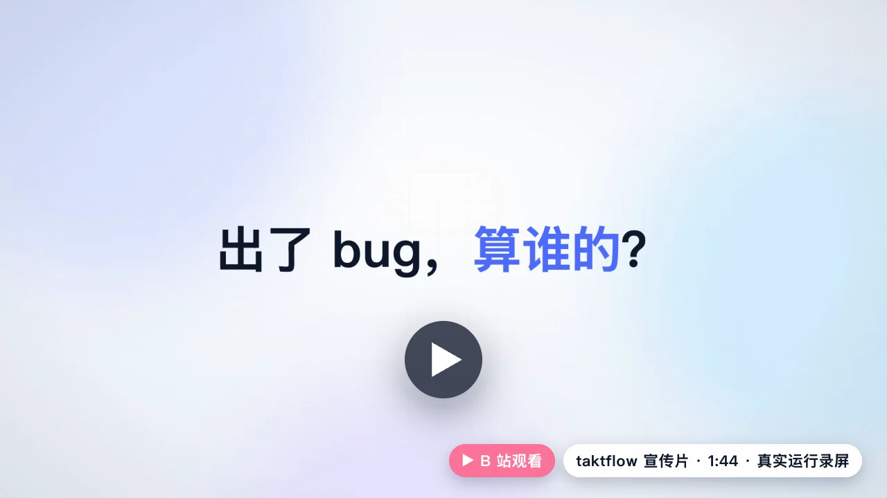
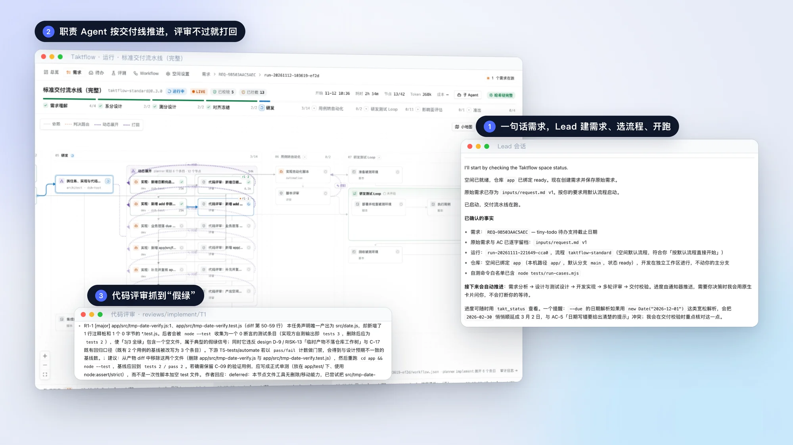
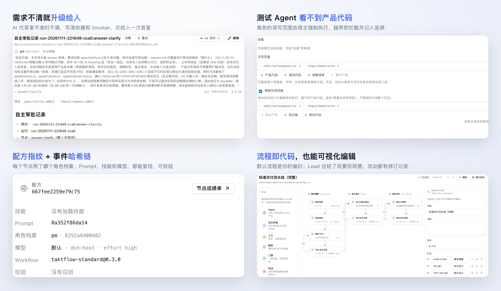
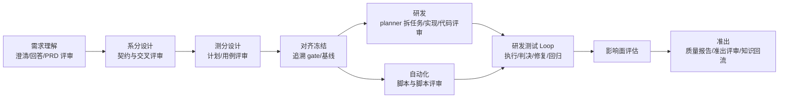

<div align="center">

<picture>
  <source media="(prefers-color-scheme: dark)" srcset="docs/assets/readme/banner-dark.svg">
  
</picture>

[](https://www.bilibili.com/video/BV1BPW96kEPg)

### 一句话提需求，一群 AI 按流程交付。<br>Lead 派活，职责 Agent 干活，交叉评审把关，每一步都有据可查。

**[DeepSeek Harness](https://github.com/deepseek-ai/deepseek-harness) 插件，开源，MIT。** 装上之后，会话里多一个 taktflow 模式，侧边栏多一个 Taktflow 面板。[开始用](#快速开始)

[](https://github.com/deepseek-ai/deepseek-harness) [](#工作原理) [](#功能) [](#自主审批档位) [](LICENSE) [](https://www.bilibili.com/video/BV1BPW96kEPg)

[功能](#功能) · [工作原理](#工作原理) · [快速开始](#快速开始) · [信任边界](#信任边界) · [文档](#文档)

</div>

<br>

<picture>
  <source media="(prefers-color-scheme: dark)" srcset="docs/assets/readme/hero-dark.webp">
  
</picture>

<p align="center"><sub>演示项目 tiny-todo（命令行待办清单）的真实运行截图：DeepSeek Harness + taktflow + deepseek-v4.1-flash。</sub></p>

## 视频介绍

1 分 44 秒看完：从一句话需求，到 AI 拿不准就升级给人、交叉评审打回、代码评审抓到“假绿”，全是真实运行录屏，流水线部分为延时摄影。**[在 B 站观看](https://www.bilibili.com/video/BV1BPW96kEPg)**

## 功能

- **一句话，Lead 接单。** 在 taktflow 模式里说需求，Lead Agent 初始化空间、建需求、选流程、启动运行，跑完回来汇报。它只派活，不写代码。普通会话遇到开发类需求时，也会弹卡片问你要不要交给 Taktflow。
- **一条完整的交付线。** 默认流程 `taktflow-standard`：需求澄清 → PRD → 系分 → 测分 → 对齐冻结 → 研发 → 用例自动化 → 研发测试 Loop → 影响面评估 → 准出，9 个阶段、30 个节点。[工作原理](#工作原理)
- **职责 Agent 分工，互相把关。** 产品、架构、测试设计、开发、自动化、评审、判决、准出等 14 个角色，每个节点交给 dsh 原生子 Agent。PRD、设计、用例、脚本和代码都要过交叉评审，不过就打回重做；用例失败先判决根因，再决定修代码、修脚本还是修用例。
- **不瞎猜，人只在关键处出场。** 需求有歧义先澄清；AI 代答拿不准就升级给人，用 dsh 原生卡片问你，回答一次，流水线自动继续。审批档位分 full、checkpoints、manual 三档。[自主审批档位](#自主审批档位)
- **职责隔离。** 测试 Agent 看不到产品代码，只按 PRD 和接口契约写用例；读写范围和技能都按角色隔离，越界即拦截；每个开发任务用独立 worktree。[信任边界](#信任边界)
- **全程可追溯。** 产物带版本、作者和溯源；每个节点有配方指纹（角色档案、Prompt、技能、模型）；运行事件是带链尾锚点的哈希链；缺陷能归因到引入它的环节。
- **流程即代码。** 流程是 TypeScript 文件，也能在面板里可视化编辑，改动都有修订记录。默认流程是你的偏好：Lead 换更重的流程要写明原因，换更轻的要你同意。
- **不怕中断。** App 退出、重启或崩溃后，运行从断点继续，已完成的节点保留。

<p align="center"></p>

## 工作原理

一个项目一个 taktflow 空间：`takt.config.json` 加上 `agents/`、`workflows/`、`skills/`、`knowledge/`、`requirements/` 几个目录，PRD、设计、用例、证据和报告都放在需求目录里，带版本和来源。需求群就是 Lead 的会话；插件在 dsh 宿主里跑流程引擎，把每个节点派给对应角色的子 Agent，主面板看进度、产物、待办和运行。



角色按各自声明的 `readScope` / `writeScope` 读写（未声明 `readScope` 表示不额外限读）：`pm` 负责需求与知识回流，`architect` 负责系分与实现拆分，`test-designer` 负责测分和用例，`dev` 只改产品代码，`reviewer` 做代码与架构评审，`release-reviewer` 只读准出材料。评审节点先由多个 reviewer 交叉评审，`humanSignoff` 打开时再弹原生审批卡；打回会进入 rework，或按耗尽策略升级给人。

### 自主审批档位

| `autonomy` | 普通 human `answer` | 普通 human `approve` | review `humanSignoff` | 适用 |
|---|---|---|---|---|
| `full` | AI（`pm`） | AI（只读 `release-reviewer`） | 关闭 | 无人值守；证据不足仍升级 |
| `checkpoints` | AI（`pm`） | 人 | 保持流程定义 | 半自动，准出必须人批 |
| `manual` | 人 | 人 | 保持流程定义 | 全程人工把关 |

空间 `takt.config.json` 的 `autonomy` 覆盖插件默认值；非法值明确失败，不静默降级。Lead 的 `takt_status` / `takt_run get` 会列出当前阶段、评审轮次、loop 轮次、待办，以及真实的升级原因和来源。

## 快速开始

1. **构建并打包插件**（需要 Node 20.12+）：

   ```bash
   git clone --recursive https://github.com/Wayzinx/taktflow-dsh.git
   cd taktflow-dsh
   npm install
   npm run build && npm run pack:takt
   ```

2. **安装到 dsh。** dsh Web：

   ```bash
   dsh plugin --profile web add /absolute/path/to/taktflow-0.0.0.tgz
   ```

   DeepSeek Harness 桌面 App 的 profile 由 App 管理，要用 App 自带的命令行安装（macOS 示例），装完退出并重开 App：

   ```bash
   "/Applications/DeepSeek Harness.app/Contents/Resources/runtime/cli/bin/dsh" plugin --profile desktop add /absolute/path/to/taktflow-0.0.0.tgz
   ```

3. **新建一个 taktflow 模式的会话**，工作目录指向你的项目根，直接对 Lead 说人话，例如：

   > 这个目录还不是 taktflow 空间，帮我初始化，然后建一个需求：给 `src/add.js` 增加 `sub(a, b)` 函数并补测试，建好后直接按默认流程开始。

4. **在 Taktflow 面板看进度**：需求、运行、待办和产物版本都在这里；运行结束后 Lead 会收到通知并汇报结果。

<sub>模型网关较慢时，给 dsh 的模型提供方配置 `timeoutMs`（例如 `600000`），避免长上下文请求超时；设了 HTTP 代理时，把模型端点的确切主机名加进 `NO_PROXY`（dsh 不认网段写法）。详见 [开发说明](docs/development.md)。</sub>

## 信任边界

- **人工入口不允许 AI 冒充人。** 原生审批卡片和主面板入口写入的 actor 都是 `human`；`takt_ask_human` 不能由子 Agent 直接调用。AI 代答只发生在 `autonomy` 允许的普通 human answer 和 `full` 档 approve，actor 是 `agent` 且 `onBehalfOf` 必须是需求绑定的人，决策正文写到 `decisions/auto-answers/`，事件链可校验。
- **AI 不伪造人工决定。** 低置信度、blocker、未解决项、准出材料缺失或截断、loop 耗尽、judge 路由到 human 时一律升级给人，待办保持未回答。
- **职责 Agent 默认没有 shell。** 声明了 `readScope` / `writeScope` 的角色按声明限制；路径先规范化再 realpath，越界、符号链接和未知工具类型 fail closed。流程模块和函数型 `script` 在宿主进程内执行，字符串 `script` 与环境命令由宿主以 `sh -c` 子进程执行，都不是安全沙箱。
- **技能按角色隔离。** 角色只看到自己声明的 skills；运行开始时冻结 SKILL.md 正文，实际注册的技能写进 trace。
- **单写者。** 每个空间同一时间只有一个宿主持有租约；审批落账、运行推进和卸载清理都先校验租约。
- **仓库隔离。** 每个任务使用独立 worktree，不动你的主分支。

## 当前状态

早期开发中。P0 骨架、缺陷归因、可视化配置、普通会话转交、断点续跑已经完成；标准流程 `taktflow-standard` 在真实 dsh + 真实模型上已能跑到研发测试 Loop，全链端到端通过还没有验证。里程碑和每批真实验证的结果见 [docs/status.md](docs/status.md)。

## 文档

[产品方案](docs/01-产品方案.md) · [技术方案](docs/02-技术方案.md) · [真实流程说明](docs/real-flow.md) · [受控自测](docs/controlled-selftest.md) · [spike 记录](docs/spike-notes.md) · [开发说明](docs/development.md) · [里程碑与验证](docs/status.md)

## 开发

```bash
git clone --recursive https://github.com/Wayzinx/taktflow-dsh.git
cd taktflow-dsh
npm install
npm run build && npm run typecheck && npm test
```

`vendor/taktflow` 是 [taktflow](https://github.com/Wayzinx/taktflow) 的 git 子模块，构建时直接打包它的源码，所以插件没有运行时依赖。联调本地的 taktflow checkout 可以设 `TAKTFLOW_DIR=/path/to/taktflow`。

在隔离的 dsh profile 里做端到端验证（不会动你自己的 `~/.dsh`），需要一个兼容 OpenAI chat completions 的模型端点：

```bash
TAKT_E2E_BASE_URL=... TAKT_E2E_MODEL=... TAKT_E2E_API_KEY=... npm run e2e           # profile + boot
TAKT_E2E_BASE_URL=... TAKT_E2E_MODEL=... TAKT_E2E_API_KEY=... node e2e/p0.mjs        # 完整 P0（历史演示流程）
TAKT_E2E_BASE_URL=... TAKT_E2E_MODEL=... TAKT_E2E_API_KEY=... node e2e/standard.mjs  # 完整标准流程
```

## Star History

<a href="https://www.star-history.com/#Wayzinx/taktflow-dsh&Date">
  <picture>
    <source media="(prefers-color-scheme: dark)" srcset="https://api.star-history.com/svg?repos=Wayzinx/taktflow-dsh&type=Date&theme=dark" />
    <source media="(prefers-color-scheme: light)" srcset="https://api.star-history.com/svg?repos=Wayzinx/taktflow-dsh&type=Date" />
    
  </picture>
</a>

## 许可

[MIT](LICENSE)
