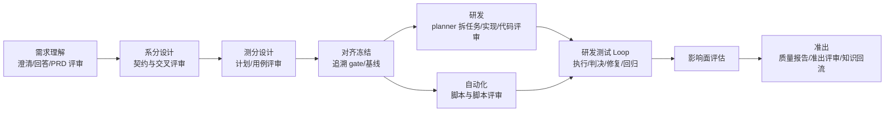

# taktflow for DeepSeek Harness

> 🚧 M-J 开发中：历史 P0 演示流程（`p0-delivery`）的真实 dsh + 真实模型批次 25/25 通过；新版标准流程（`taktflow-standard`）的真实 e2e 已执行 5 批，前 4 批未通过（第 1 批 Lead 动态流程目录遗漏已修；第 2/3 批 sandbox 包解析失败已修；第 4 批跑到研发测试 loop，因 REG-001 缺基线环境变量被 judge 升级），第 5 批在研发测试 loop 后升级给人、整体 `ok=false`，标准全链成功尚未验证。模块实现和构建、类型检查与单测为 35 文件 / 548 项通过。P1（从节点重跑、产物回退、配方指纹、归因视图）仍在计划中。

把 [taktflow](https://github.com/Wayzinx/taktflow) 做成 [DeepSeek Harness](https://github.com/deepseek-ai/deepseek-harness)（dsh）插件：**装一个插件，dsh 就多了一条"需求交付线"**。

- **一个项目一个空间，可承载多个需求。** PRD、设计、用例、证据、报告都放在需求目录里，带版本和来源。
- **需求群就是 Lead 的会话。** 你和 Lead Agent 对话；Lead 按流程派发职责 Agent（dsh 原生子会话），自己不写代码。
- **人工入口只接受人，AI 代答不冒充人。** 审批卡片用 dsh 原生的提问卡片，人工入口写入的 actor 是 `human`；`full` 档普通 human 节点由宿主 AI 按冻结证据代答，actor 是 `agent` 且 `onBehalfOf` 是需求绑定的人。主面板看进度、产物和运行。
- **可追溯、可审计。** 产物版本和声明依赖、运行事件哈希链（带链尾锚点）；从节点重跑、产物回退、配方指纹、归因视图在 P1 计划中。

## 文档

- [产品方案](docs/01-产品方案.md)：定位、用户旅程、界面、范围与里程碑
- [技术方案](docs/02-技术方案.md)：架构、dsh 接口用法、权限与生命周期、审计口径、实施计划
- [spike 记录](docs/spike-notes.md)：在真实 dsh 上的验证结果和踩坑
- [开发说明](docs/development.md)：内部接口、构建、隔离 e2e

## 状态

| 里程碑 | 内容 | 状态 |
|---|---|---|
| P0 骨架 | 打包、安装、宿主加载、Lead preset、最小面板；隔离 profile 下的真实安装验证（S4） | ✅ |
| P0 业务（历史演示流程） | dsh 原生职责 Agent、权限守卫、单写者租约、审批链路、Lead 工具、主面板；真实 dsh + 真实模型跑 `p0-delivery` 演示流程，最终批次 25/25 | ✅ 历史批次 |
| M-J 标准流程 | `taktflow-standard`、角色能力、autonomy、run-status、状态工具与文档；构建/类型/单测 35 文件 548 项通过；真实 dsh + 模型 standard e2e 已执行 5 批，前 4 批未通过（目录遗漏与 sandbox 包解析已修；第 4 批跑到 loop，5 轮评审、9 条生成用例 8 过 1 失败，因缺基线环境变量升级）；第 5 批跑到 loop 后升级给人（34 项 26 过 8 失败，`ok=false`） | 🚧 到人工升级，未全链通过 |
| P1 / P2 | 从节点重跑、产物回退、配方指纹、归因视图 | 计划中 |

第 5 批最终结果：run `run-20261106-124857-4d67`，34 项验收 26 通过 / 8 失败、整体 `ok=false`；生成 12 条业务用例首轮 9 过 3 失败，独立 6 项产品 AC 通过；研发测试 loop 的 judge 停在 `waiting_human`，最终升级待办保持未回答。未到质量报告/准出/知识回流，不宣称标准全链通过。证据归档见 `e2e/out/standard-history/`。

## 信任边界

- **人工入口不允许 AI 冒充人。** 原生审批卡片和主面板入口写入的 actor 都是 `human`；`takt_ask_human` 不能由子 Agent 直接调用。AI 代答只发生在 `autonomy` 允许的普通 human answer 和 `full` 档 approve，actor 是 `agent` 且 `onBehalfOf` 必须是需求绑定的人，决策正文写到 `decisions/auto-answers/`，事件链可校验。
- **AI 不伪造人工决定。** 低置信度、blocker、未解决项、准出材料缺失/截断、loop 耗尽、judge 路由到 human 时一律升级给人，待办保持未回答；不会用固定答案冒充 AI 判断。
- **dsh-host 下的职责 Agent 默认没有 shell。** 声明了 `readScope`/`writeScope` 的角色按声明限制，未声明 `readScope` 表示不额外限读；路径先规范化再 realpath，越界、符号链接和未知工具类型 fail closed。`dsh-host` 模式统一用 App 模型；`profile` 模式走外部 CLI/fallback，shell 能力由 CLI 自身决定，不由 dsh 工具守卫保证。流程模块和函数型 `script` 回调在宿主进程内执行；字符串形式 `script` 与环境命令由宿主以 `sh -c` 子进程执行，但没有额外安全沙箱。
- **技能按角色隔离。** 角色档案只看到自己声明的 skills；运行开始时冻结 SKILL.md 正文，等待期间改文件不会改变已启动节点的能力，实际注册的技能会写进 trace。
- **单写者。** 每个空间同一时间只有一个宿主持有租约；审批落账、运行推进和卸载清理都先校验租约，避免 CLI 与插件同时写。
- **仓库隔离。** 每个任务使用独立 worktree；标准流程按 `app` 引用主仓库，只有“唯一 legacy main”会追加别名并保留 `main`，多仓库不会被改名合并。

## 标准流程



角色按各自声明的 `readScope`/`writeScope` 读写（未声明 `readScope` 表示不额外限读）：`pm` 负责需求与知识回流，`architect` 负责系分与实现拆分，`test-designer` 负责测分/用例，`dev` 只改产品代码，`reviewer` 做代码与架构评审，`release-reviewer` 只读准出材料。评审节点先由多个 reviewer 交叉评审，`humanSignoff` 打开时再弹原生审批卡；打回会进入 rework 或按耗尽策略升级。

## 自主审批档位

| `autonomy` | 普通 human `answer` | 普通 human `approve` | review `humanSignoff` | 适用 |
|---|---|---|---|---|
| `full` | AI（`pm`） | AI（只读 `release-reviewer`） | 关闭 | 无人值守；证据不足仍升级 |
| `checkpoints` | AI（`pm`） | 人 | 保持流程定义 | 半自动，准出必须人批 |
| `manual` | 人 | 人 | 保持流程定义 | 全程人工把关 |

空间 `takt.config.json` 的 `autonomy` 覆盖插件默认值；非法值明确失败，不静默降级。Lead `takt_status` / `takt_run get` 的 `runStatus` 会列出当前阶段、评审轮次、loop 轮次、待办以及真实升级原因/来源（决策产物路径@版本）；HTTP GET `p=run` 仍返回 core `RunDetail`。

## 在 dsh 里怎么用

1. 安装插件（构建和打包见“开发”）：

   ```bash
   npm run build && npm run pack:takt
   dsh plugin --profile web add /absolute/path/to/taktflow-0.0.0.tgz
   ```

2. 打开 dsh Web，在侧边栏新建一个 **taktflow** preset 会话，工作目录指向你的项目根。
3. 直接对 Lead 说人话，例如：“这个目录还不是 taktflow 空间，帮我初始化，然后建一个需求：给 `src/add.js` 增加 `sub(a, b)` 函数并补测试，建好后直接启动标准交付流程。”
4. Lead 会依次初始化空间、创建并绑定需求、启动 `taktflow-standard`。默认 `full` 档：普通澄清和准出由宿主 AI（`pm` / `release-reviewer`）按冻结证据代答或判定，低置信、blocker、证据不足才升级给人；需要人工检查点时把 `autonomy` 设为 `checkpoints` 或 `manual`。
5. 在主面板看需求、运行、待办和产物版本；运行结束后 Lead 会收到 `[taktflow]` 通知并汇报结果。`dsh-host` 下职责 Agent 默认没有 shell，代码改动由 dsh 子 Agent 完成；流程的字符串 `script` 与环境命令由宿主以子进程执行 shell；函数型 `script` 在宿主进程内执行，都不是安全沙箱。

## 开发

```bash
git clone --recursive https://github.com/Wayzinx/taktflow-dsh.git
cd taktflow-dsh
npm install
npm run build && npm run typecheck && npm test
```

`vendor/taktflow` 是 taktflow 的 git 子模块，构建时直接打包它的源码，所以插件没有运行时依赖。联调本地的 taktflow checkout 可以设 `TAKTFLOW_DIR=/path/to/taktflow`。

在隔离的 dsh profile 里做端到端验证（不会动你自己的 `~/.dsh`），需要一个兼容 OpenAI chat completions 的模型端点：

```bash
TAKT_E2E_BASE_URL=... TAKT_E2E_MODEL=... TAKT_E2E_API_KEY=... npm run e2e       # profile + boot
TAKT_E2E_BASE_URL=... TAKT_E2E_MODEL=... TAKT_E2E_API_KEY=... node e2e/p0.mjs  # 完整 P0（历史演示流程）
TAKT_E2E_BASE_URL=... TAKT_E2E_MODEL=... TAKT_E2E_API_KEY=... node e2e/standard.mjs  # 完整 standard
```

P0 脚本会跑初始化、建需求、启动、人工审批、产物/测试/审计/面板/通知，脱敏结果写到 `e2e/out/p0-result.json`。standard 脚本跑完整标准流程；真实 e2e 已执行 5 批，前 4 批未通过，第 5 批跑到研发测试 loop 后升级给人、整体 `ok=false`，标准全链成功尚未验证；批次证据归档在 `e2e/out/standard-history/`。

如果环境里设了 HTTP 代理，记得把模型端点的确切主机名加进 `NO_PROXY`（dsh 不认网段写法），见 [开发说明](docs/development.md)。

## 许可

MIT
