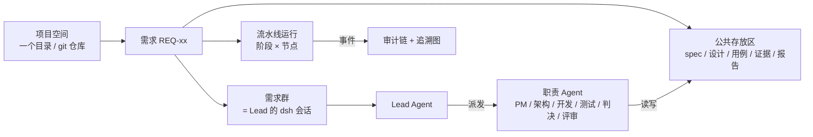

# taktflow for DeepSeek Harness · 产品方案

> 状态：v2.1（2026-11-05），已按两轮评审修订（评审：Codex gpt-6-astra xhigh）。技术方案见 [02-技术方案](02-技术方案.md)。

## 一句话

**装一个插件，DeepSeek Harness（dsh）就多了一条"需求交付线"。** 每个需求有自己的项目空间和一个需求群。群里的 Lead Agent 带着几个职责 Agent，把需求从设计推进到开发、测试和交付。人只做两件事：把关，看进度。任何一个产物都能追到是哪次运行、哪个角色、基于哪些输入版本做出来的；出了问题能回退、能从某一步重跑，然后改进流程。

## 解决什么问题

| 痛点 | 现状 | taktflow 给的 |
|---|---|---|
| 信息散 | PRD、设计、用例、结论散落在各个会话和文档里。Agent 之间靠"记住"传话，上下文一压缩就丢 | **需求空间**：一个需求一个目录，所有人和 Agent 都从这里取、往这里放，产物带版本 |
| 过程黑盒 | AI 十分钟写完，不知道为什么这么写，出了 bug 不知道是哪一环的问题 | **追溯与归因**：每个产物都知道来源、作者和声明的输入版本；失败能沿依赖链列出可疑环节（是线索，不是定论） |
| 流程改不动 | 改了提示词或流程，说不清是变好还是变坏 | **配方指纹 + 度量**：每次运行都记下用的是哪版流程、角色、Skill 和模型，可以前后对比 |
| 人被拖进细节 | 要盯着 Agent 一步一步走 | **人只把关**：审批点、待办卡片、进度条；其余由 Lead 推进 |

## 和 dsh 生态同类插件的区别

dsh 社区已经有一些"多角色流水线"插件，所以 taktflow **不把"有很多角色和阶段"当卖点**。

| 插件 | 做得好的 | taktflow 不同在哪 |
|---|---|---|
| dsh-expert-team | 一句话拉起 12 个角色、9 个门控阶段 | 流程是**代码定义的 DAG**，可以改、可以复用；以需求为单位长期存在，不按一次运行组织 |
| ai-native-sdlc-dsh | 稳定的问题编号、裁决绑定代码版本、冻结测试、改进效果对比、侧栏看板 | 多 Agent 协作，加上**需求级的版本依赖和影响重算**：改了上游，下游哪些节点过期一目了然 |
| dsh-graph | 目标看板，功能多 | 我们**刻意少工具**（6 个，它有 53 个），用 Agent 的调用成功率来衡量 |
| DS-Bot / Agent Teams | 常驻 bot、群聊、任务板 | 我们的群聊绑定一个需求，群里通过 taktflow 做的改动都留有记录：产物版本、待办答复、运行事件；运行内的事件进哈希链 |

**一句话差异化：可编程的交付 DAG + 需求级版本依赖与影响重算 + 一条线里混用多种 harness（dsh 原生、Codex、Claude Code……）。** 社区 SDLC 插件在"独立验证"上做得很扎实，taktflow 不和它比验证深度，重点放在流程编排和变更影响。

## 核心概念



| 概念 | 是什么 | 用户在哪里看到 |
|---|---|---|
| 项目空间 | 一个目录（推荐独立 git 仓库），放配置、角色、流程、Skill 和全部需求 | 主面板左上角的空间切换 |
| 需求 | 交付单位，有阶段、状态、成员和外部链接 | 主面板需求列表 |
| 需求群 | 选「taktflow」模式新建的 dsh 会话，绑定一个需求 | dsh 左侧会话列表 |
| Lead Agent | 需求群里的"项目经理 + 调度员"，不写代码 | 群里的 AI |
| 职责 Agent | 被派去完成一个节点或临时任务的 Agent，各自有角色、模型和写权限 | 群里的进度消息，可打开它的会话记录；要追问就派一个只读问答任务 |
| 流水线 | 代码定义的 DAG（阶段 → 节点），带门禁、人工审批和判决路由 | 需求详情 →「流程」 |
| 产物 | 存放区里的文件，每次修改生成新版本，并记录来源 | 需求详情 →「产物」 |
| 待办 | 需要人决定的事：审批、回答、判决复核 | 群内卡片、输入框上方状态条、主面板待办 |
| 配方 | 一次节点运行用到的全部"原料"的指纹 | 节点详情 →「配方」，可对比 |

## 用户旅程

1. **安装**：在 Plugins 页添加 `taktflow`，或者执行 `dsh plugin --profile web add taktflow`。左侧栏会出现 taktflow 图标，新建会话时多一个「taktflow」模式。
2. **建空间**：在主面板点"新建空间"，选一个目录，会生成 `takt.config.json`、默认角色和默认流水线；也可以打开已有空间。
3. **开需求**：新建会话、选「taktflow」模式，对 Lead 说"新需求：给登录页加验证码，PRD 在这个链接"。Lead 会创建 `REQ-12`，把这个会话绑定成 REQ-12 的需求群，把 PRD 快照放进存放区，然后问你要不要启动默认流水线。
4. **推进**：Lead 启动流水线，按阶段派发职责 Agent。群里会陆续出现阶段卡片（"系分完成，产出 design.md v1"）和审批卡片（"spec 需要你确认"）。输入框上方的状态条一直显示 `REQ-12 · 系分 2/7 · 1 个待审批`。
5. **随时问**："现在卡在哪？""架构师为什么选 Redis？"Lead 会读状态快照和存放区回答。涉及某个节点的细节时，可以直接打开那个职责 Agent 的会话记录；也可以让 Lead 派一个**只读的问答任务**，把那次运行的记录和产物作为输入来回答。不会直接在原会话里续聊，因为续聊会绕过权限和记账。
6. **出问题**：测试失败后，判决 Agent 归因为 `product_bug` 并路由给开发修复。如果你怀疑是 spec 写错了，在失败用例上点"为什么？"，能看到沿**声明依赖**整理出的链路：用例 → 它覆盖的 AC → spec v2（哪次运行、哪个角色、声明读了 PRD v1）→ 系分 v1，可疑环节排在前面并写明理由。你可以把 spec 回退到 v1 或者改一版，下游节点自动标成"过期"，再选择从哪一步重跑。
7. **交付和复盘**：报告和准出结论落进存放区。「度量」页给出这个需求的首跑可用率、返工轮次、人工介入次数和成本（标明哪些是真实值、哪些是估算、是否包含 Lead 自己的消耗），还有**疑似引入阶段分布**（按判决类别推断，可以人工纠正）。改了流程或提示词之后，可以用"配方对比"看效果。

## 界面

界面原则：**每块界面只回答一个问题**；全部使用 dsh 主题，看起来是 dsh 自己的一部分。

### 1. 需求群（dsh 原生会话）

- 就是 Lead 的会话，人和 Lead 在这里对话。
- taktflow 的事件以简短的系统消息进群，例如"▶ 系分开始（架构 · deepseek）""✓ 系分完成 · design.md v1""⏸ 等待审批：spec"。
- 审批卡片用 dsh 原生的"向用户提问"卡片，可以直接点"批准 / 打回 + 理由"。答案只能由人给出，Lead 无法替人审批。
- 审批卡片必须讲清三件事：**批的是哪个产物的哪个版本**（附 diff）、**批了会推进什么**、**打回会怎样**（回到哪一步、谁来改）。没答、取消、超时都不算批准。

### 2. 输入框上方状态条（常驻）

```
┌──────────────────────────────────────────────────────────────────────────┐
│ ◆ REQ-12 登录验证码   需求✓ 系分● 测分○ 冻结○ 研发○ 影响○ 报告○   ⏸ 1 待审批 │
└──────────────────────────────────────────────────────────────────────────┘
```

回答"现在到哪了、要不要我做事"。点一下打开主面板的对应需求。

### 3. 主面板 taktflow（点左侧图标打开）

```
┌ 空间：login-svc ▾ ─────────────────────────────────────────────────────────┐
│ 总览 │ 需求 │ 待办(3) │ 度量 │ 设置                                         │
├──────┴──────────────────────────────────────────────────────────────────────┤
│ 进行中 4   已交付 12   阻塞 1   本周成本 ¥38                               │
│ ID      标题          阶段                         待办   负责人   群聊     │
│ REQ-12  登录验证码    ✓ ✓ ● ○ ○ ○ ○                1      alice    ↗        │
│ REQ-11  导出限流      ✓ ✓ ✓ ✓ ✕ ○ ○  研发失败       0      bob      ↗        │
└────────────────────────────────────────────────────────────────────────────┘
```

需求详情分 6 个 Tab：

| Tab | 回答什么 | 内容 |
|---|---|---|
| 流程 | 跑到哪了、哪一步出了问题 | DAG 画布（按阶段分列），点开节点看：概览 / 输入输出 / Trace / 上下文 / 判决 / 配方 / Prompt；可"从这里重跑" |
| 产物 | 有哪些东西、是什么版本 | 按类别分组；预览、版本切换、对比、编辑（必填原因）、回退、评论；显示"读过它的节点" |
| 追溯 | 每条验收标准有没有验证 | AC 覆盖卡片 + 追溯图（REQ → AC → 用例 → 证据 → 判决；spec → 任务 → 代码改动） |
| 归因 | 这个问题可能是哪一环引入的 | 选一个失败用例、判决或产物 → 沿声明依赖的上游链路，可疑环节排序并附理由和配方（是线索，不是定论） |
| 审计 | 谁在什么时候做了什么，运行记录有没有被改 | 事件时间线（人、Lead、Agent、系统，人的操作标明来源）；运行事件链校验结果；dsh 会话链接 |
| 度量 | 交付质量和成本 | 首跑可用率、返工轮次、人工介入、判决分布、疑似引入阶段分布、token 和成本（标明真实/估算/未知） |

## Lead Agent 能做什么、不能做什么

| 能做 | 不能做 |
|---|---|
| 回答进度和设计问题（读状态快照和产物） | 替人审批、替人回答待办 |
| 启动、继续、取消流水线；从某个节点重跑（P1） | 直接写代码：Lead 的工具是**白名单**，没有 shell、写文件、workflow 脚本和子 Agent 派发 |
| 派发临时任务给某个角色（例如"改一下按钮文案"），任务和流水线节点一样留痕 | 直接修改 spec、设计等产物：只能派任务去改，或者提出修改交人批准 |
| 向人发起审批或提问 | 修改流程定义（只能提出修改，由人批准） |
| 写自己的备忘和澄清记录（`decisions/lead-notes.md`、`clarifications/`），作者记为 Lead，不冒充人 | — |

## 可追溯、可审计、可回滚（核心能力）

1. **每个产物都能回答"从哪来"**：版本、作者（人或哪个角色和模型）、哪次运行的哪个节点、**声明的**输入版本、修改原因。界面上写明这是"声明依赖"，不是"实际读过的字节"。
2. **每个失败都能给出"可能是哪一环"**：从判决和失败用例沿依赖往上游追，列出链路和可疑环节（例如"spec v2 的 AC-3 和 PRD 矛盾"），附上那一环的配方。这是排查线索，不是定论，人可以纠正。
3. **运行记录可校验**：运行事件只追加、用哈希链串起来，并记录链尾，删改或截掉一段都能被校验出来；Agent 的完整对话保留在 dsh 会话里，审计记录会话链接。需求级的完整账本（评论、需求字段修改也进链）是后续工作。
4. **能回滚，而且不丢历史**：
   - 产物回退：用旧内容生成新版本并写明原因，下游自动标"过期"；
   - 流程重跑：从任意节点重跑，复用上游已有版本；
   - 代码回滚：开发任务在独立分支（git worktree）上做，回滚就是丢掉分支或 revert 合并提交（第二阶段）。
5. **流程能迭代**：配方指纹加上疑似引入阶段分布，可以回答"上周改了评审提示词以后，研发阶段被打回的次数降了没有"。

## AI 友好的设计原则

1. **文件优先**：Agent 用 dsh 自带的读写工具直接操作需求目录，不需要学新东西；taktflow 工具只负责必须"记账"的操作。
2. **工具少而全**：Lead 只有 6 个工具（status、requirement、artifact、run、trace、ask_human），用 `action` 参数区分子操作。**衡量标准是 Agent 的调用成功率，不是工具个数**：每个 action 都有明确的参数 schema、权限、异步返回约定；创建和启动类操作带幂等键，写入类带基准版本。
3. **一份快照就能接手**：`STATUS.md`（给人看）和 `status.json`（给 Agent 读）随每个事件刷新，任何 Agent 冷启动读一份就够。
4. **ID 稳定、能直接搜索**：REQ、AC、TC、`产物@版本`、RUN、节点 ID 在文件名和内容里都出现。工具结果总是带上这些 ID 和"下一步可以做什么"。
5. **报错可以直接用**：每个错误都有错误码、原因和一条修复建议。
6. **固定的提示词和变化的状态分开**：系统提示词只放角色说明，保持不变，模型缓存能复用；变化的状态作为增量消息注入。

## 范围与里程碑

| 阶段 | 做什么 | 验收 |
|---|---|---|
| **P0 走通** | 一个空间、一个绑定的 Lead 会话；status / start / cancel；随包附带的精简流程（含**一个真实的 dsh 原生职责节点**和**一次人工审批**）；运行审计；主面板最小版（总览 + 需求 + 运行）。先做 5 个 spike 再写正式代码 | 真实模型下：Lead 启动流程 → 职责 Agent 在权限范围内写出产物 → 审批卡片批准 → 交付；取消后不再有写入；重复启动只执行一次；运行事件链校验通过。mock 的 `hello-delivery` 只作回归 |
| **P1 可用** | 从节点重跑；产物编辑和回退（带基准版本）；临时任务；只读问答任务；状态条；需求详情（流程、产物、审计）；用户自己的流程文件 | 新建需求 → 审批 → 交付全程不离开 dsh；能打开任一职责 Agent 的会话记录 |
| **P2 可追溯** | 配方指纹；归因视图；疑似引入阶段分布（稳定问题 ID、人工纠正）；代码 worktree 回滚；会话证据快照；群内富卡片 | 能从一个失败用例沿依赖追到可疑环节和它的配方；分布数据和事件日志对得上 |
| **P3 生态** | 把 Codex / Claude Code / Gemini 等注册为 dsh 子 Agent 来源；插件市场索引；OpenTelemetry 导出；和 Agent Teams 互通 | 发布到 npm 和 GitHub topic `dsh-plugin`；兼容性 CI 通过 |

## 不做什么

- P0 不支持"暂停后原样续跑"：运行期间 dsh 宿主和需求群需要在线，宿主退出、插件卸载、需求群离线都会让在途运行以"已取消（附原因）"结束，可以重新启动。P1 提供从某一步续跑和可恢复的暂停。
- P0 的职责 Agent 没有 shell：测试由流程里的脚本节点执行，不由 Agent 自己跑命令，这样写权限范围才真正可控。

- 不重新实现 dsh 已有的能力：聊天、子 Agent 运行、沙箱、Skill 系统、轨迹视图、插件市场。
- 不做通用看板或项目管理（排期、工时）。只管"需求从设计到交付"这条线。
- 不承诺强安全：哈希链能防"悄悄改一条"，防不了有写权限的人整链重算。要强审计，请配合 git 提交和服务端分支保护。
- P0–P1 不支持多人实时协作（dsh 本身是单用户本地应用）。多人通过共享空间仓库和 git 协作。

## 成功指标（开源）

- 安装后 **15 分钟内**跑完第一个需求（mock 或真实模型）。
- 归因可用：标注过的失败样本里，"最可疑环节"命中率 ≥ 70%（用示例项目的种子缺陷来评测）。
- 稳定：插件自身代码不留未处理的 Promise 拒绝；P0 只执行随包附带、经过验证的流程（用户自己的流程代码在宿主进程里跑，信任边界和普通插件一样，P1 再放开）；dsh 小版本升级后兼容性 CI 能提前报警。

## 已定的取舍（采纳评审建议）

1. **独立 Web**：保留运行能力，继续维护，但不再加大功能。核心库、CLI、HTTP 入口继续支持诊断、CI 和脱离 dsh 使用；两边共享纯组件，dsh 的依赖不进 core。
2. **职责 Agent 的执行后端**：默认 dsh 原生，后端名叫 `dsh-host`，不和已有的 `dsh`（命令行）后端混用；需要 Codex、Claude Code 的节点走 taktflow 现有适配器。各后端分别声明续聊、沙箱、模型、用量能力，不会暗中互换。
3. **包名**：dsh 插件叫 `taktflow`（备选 `@taktflow/dsh`），CLI 包叫 `@taktflow/cli`，命令仍是 `takt`。安装说明写清各个 profile（desktop / web）的步骤。
