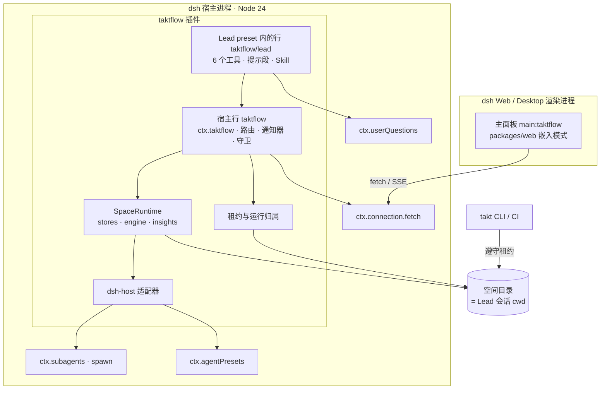
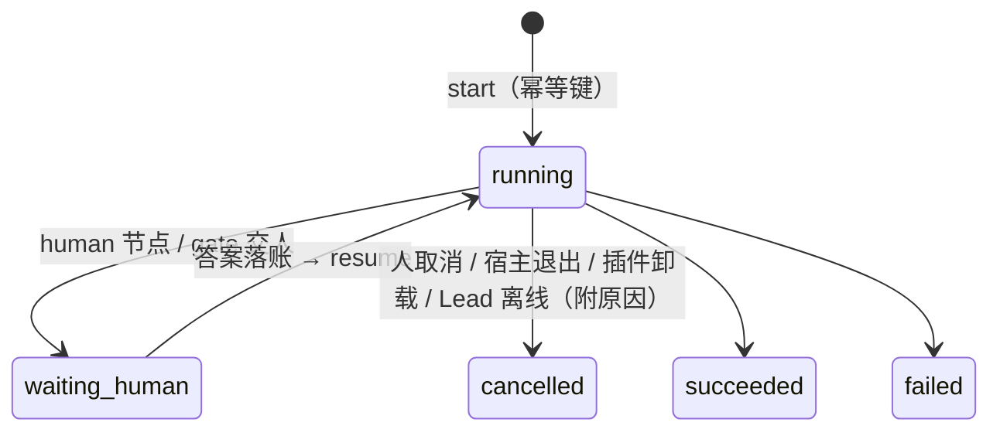

# taktflow for DeepSeek Harness · 技术方案

> 状态：v2.1（2026-11-05），已按两轮评审修订（Codex gpt-6-astra xhigh）。第一轮结论"修改后可以进入实现"；复审列出最少必要修改 5 项，已在 v2.1 处理，处理记录见第 0 节。产品方案见 [01-产品方案](01-产品方案.md)。
> 目标宿主：dsh `0.2.1-rc.3`（本机桌面版）；npm `next` 已到 `0.2.2-rc.1`。
> 标记：✅ 已对照类型定义、官方文档或社区插件的可运行代码核实；⚠️ 需要 spike 验证。

## 0. 评审处理记录

| # | 评审意见（必须修改） | 处理 |
|---|---|---|
| 1 | 协议里有的能力不等于已经实现 | 新增第 2 节能力基线。P0 只用已实现的能力；未实现的节点类型一律报错，不能当作成功 |
| 2 | 缺执行所有权，会重复执行 | 跨进程的空间租约 + 运行归属（5.3）。CLI 不推进插件拥有的运行；运行中不热替换 Runtime；接管失主运行要人工确认 |
| 3 | 取消、离线、中断混在一起 | `abort → dispose` 立即生效（5.5）；暂停原因单独记录（5.4）；P0 不自动恢复 |
| 4 | 临时 preset 和事后续聊冲突 | 不在原会话续聊，改为查看会话记录 + 只读问答任务；preset ID 带空间和配置哈希，按需重新注册（5.5） |
| 5 | `cwd` 不等于沙箱授权，守卫有启动窗口 | 落点约束：子会话的可写根就是 Lead 会话的 cwd（= 空间根）；预留 childId，先挂权限再启动；系统元数据精确登记（5.6） |
| 6 | Lead 去不干净，`write/revert` 开了后门 | Lead preset 改为白名单组合；Lead 只能写备忘和澄清记录；身份来自可信上下文，不冒充人（5.7、5.8） |
| 7 | 审批链路缺失 | 用 `userQuestions.ask()`，AttentionStore 是权威；答案绑定请求、尝试次数和产物版本，重复回答幂等；未答、取消、超时都不算批准（5.9） |
| 8 | workflow 导入改写不成立，稳定性承诺过头 | P0 只执行随包附带的流程；用户流程的加载器放到 P1 单独设计；收窄稳定性承诺（5.11、8） |
| 9 | 配方指纹的材料和时点不对 | 改成在 harness 请求组装完成后、按尝试记录的新事件 `node.recipe`；界面写"声明依赖"（7.2） |
| 10 | 审计和矩阵的承诺过强 | P0 承诺"运行事件链内一致 + 链尾锚点防截断"；矩阵改为"疑似引入阶段分布"，需要稳定问题 ID，放到 P2（7.1、7.4） |

**复审（第二轮）的最少必要修改**：

| # | 复审意见 | v2.1 处理 |
|---|---|---|
| A | 租约要覆盖所有写入口；rename 接管不互斥 | 所有租约状态变化都在跨进程文件锁（core 现有的 `withFileLock`）里完成；`takt serve` 的写操作和答复后的恢复也受租约约束（5.3） |
| B | dispose 之后不能假定还能原样 resume | P0 不做可恢复的暂停：宿主退出、插件卸载、Lead 离线 → 运行以 cancelled（附原因）结束；可恢复暂停（`Engine.suspend`）放到 P1（5.4，R10） |
| C | 任意 shell 绕过节点写权限 | P0 的所有角色都没有 shell；测试由流程里的 script 节点执行；dsh-host 节点声明 `allowBash` 时，流程校验直接拒绝（5.6） |
| D | 待审产物和版本要在创建待办时冻结 | 引擎创建待办时写入 `attempt` 和 `subjects`（取自当时的 `NodeState.inputs`），回答时逐项比对（5.9，R9） |
| E | 链尾锚点会被正常追加覆盖；首次 create/bind 授权循环；能力类型不兼容；审计文案不一致 | 追加前在锁内核对旧链尾和锚点，不一致就拒绝追加；两文件之间中断记为 incomplete（7.1）。首次 create/bind 单独定义初始化授权（5.8）。`sandbox: false`（5.5）。产品文案统一 |

建议修改全部采纳：容量错误的真实名称、outputSchema 预检、inject 的消费时机、web 嵌入不能只给 CSS 加前缀、server 只抽共享方法、工具契约要有幂等键和基准版本、差异化收窄、P0 重排。三个开放问题按评审建议定下，见产品方案末尾。

## 1. 结论

- **一本账，多个入口，单一写者。**
  - `@taktflow/core` 不依赖 dsh。
  - dsh 适配层是本仓库（npm 包名 `taktflow`），通过 git 子模块 `vendor/taktflow` 引用 taktflow 源码并打包进产物；引擎在 dsh 宿主进程内调度。
  - 同一个空间同一时刻只有一个执行者，靠跨进程租约保证。
  - CLI 照样能读，也能推进它自己拥有的运行。
- **职责 Agent 默认是 dsh 原生子会话**（后端名 `dsh-host`）：用 `ctx.subagents.startActivation`，按角色临时注册 Agent Preset。Codex、Claude Code 等继续走 `@taktflow/harness` 的现有适配器。
- **先 spike，再冻结接口，再并行。** 生命周期、权限、单写者、安装和审计口径这 5 件事先用真实宿主验证，见第 11 节。

## 2. 能力基线（评审 #1）

| 能力 | 状态 | P0 怎么用 |
|---|---|---|
| DAG 引擎：script / agent / gate / human / judge / loop / planner；stale 传播；resume | ✅ 已实现（M0/M1） | 直接用 |
| 存放区版本与溯源、事件哈希链、待办、读模型（trace、metrics） | ✅ 已实现 | 直接用 |
| harness：claude-code、codex、dsh（CLI）、mock、native、Gemini 等 | ✅ 已实现（新 CLI 只用夹具测过） | P0 只用 mock（回归）和新增的 dsh-host |
| `review` 节点、rework、交叉评审 | ⚠️ 协议有，**实现没有**（`dsl.ts` 没有构造函数，runtime 没有分支，事件白名单也不收） | P0 的流程**不使用**；引擎碰到未知节点类型必须报错 |
| worktree、沙箱、项目空间 API、群聊 API | ⚠️ M2 进行中（另一条分支） | P0 不依赖；节点 cwd 就是空间根 |
| 插件新增 | 本方案 | dsh-host 适配器、租约与归属、Lead 工具、通知器、审批链路、嵌入式 UI |

## 3. 总体架构



**为什么调度放在宿主内：** dsh 原生子 Agent 必须由宿主内的一个活 `Agent` 作为 parent 来启动（✅ `SubagentStartRequest.parent: Agent`）。
**宿主内跑的代码范围：** P0 只有插件代码和随包附带的流程。用户自己的流程代码以后可以挪到子进程执行，调度仍然留在宿主（5.11）。

## 4. 包结构与清单

```
taktflow-dsh/                      # 本仓库，npm: taktflow（vendor/taktflow 为 taktflow 子模块）
  package.json  cordis.patch.yml  locale/{en,zh}.json  icon.svg  README.md
  src/host/
    index.ts                       # 宿主行：apply、Config、服务 ctx.taktflow
    types.ts                       # 冻结的内部接口（SpaceRuntime、RunManager、Ownership、RoleRunner、PermissionRegistry）
    space.ts                       # 会话 cwd → 空间（P0 只支持一个空间根）
    ownership.ts                   # 租约 + 运行归属
    runs.ts                        # RunManager：start / cancel / pause / resume（人工确认）
    dsh-harness.ts                 # dsh-host HarnessAdapter
    presets.ts                     # Lead / 角色 preset 组合（白名单）+ 按需注册
    permissions.ts                 # childId → 写权限范围；ctx.tools.guard
    approvals.ts                   # 待办 ↔ userQuestions；答案落账后调度
    notify.ts                      # 引擎事件 → Lead 会话 + .takt/status 快照
    routes.ts                      # /api/taktflow（读）、/api/taktflow.op（写，操作白名单）、/api/taktflow.stream
    lead/{index,tools,prompt,skill}.ts
    role/index.ts                  # 角色 preset 内的行：角色提示段 + 角色 Skill
  src/workflows/p0-delivery.ts     # 随包流程（构建期编译成 lib/workflows/*.js）
  src/client/index.tsx             # apply(ctx)：sidebar.panellist + main
  scripts/{build,preset-check,compat-check,activation-check}.mjs
  e2e/                             # 隔离 DSH_HOME 的端到端脚本
```

`package.json` 的要点：

- `exports`：`"."`（宿主）、`"./lead"`、`"./role"`、`"./client"`、`"./locale/*.json"`、`"./icon"`。`./role` 是评审指出的遗漏。
- `dsh.bundle.patch` 和 `dsh.client`（`platform: web`）。
- `engines.dsh: ">=0.2.1-rc.3 <0.3.0"`，`dependencies: {}`。
- `@taktflow/*` 由 esbuild 打进 `lib/`。`@deepseek-ai/*` 和 Node 内置模块保持 external。

`cordis.patch.yml` 有两行：

- 宿主行 `taktflow`，必须写精确包名，否则浏览器半不会被发现（✅ 社区踩坑 §13）；
- Lead preset 声明，用 `@deepseek-ai/dsh-agent-preset`，组合见 5.7。

## 5. 宿主侧设计

### 5.1 插件行与 inject

| 行 | 位置 | inject（只写确定存在的服务） | 可选服务（用 `ctx.get` 读） |
|---|---|---|---|
| `taktflow` | 宿主 | `connection`、`subagents`、`agents`、`tools` | `agentPresets`、`storageDomain` |
| `taktflow/lead` | Lead preset | `taktflow`、`tools`、`systemPrompt`、`skills` | `userQuestions` |
| `taktflow/role` | 角色 preset | `taktflow`、`systemPrompt`、`skills` | — |

inject 里多写一个不存在的服务，插件会静默停在 `pending`（✅ 社区踩坑 §12.3）。所以冒烟测试要断言 inject 的每个名字都能被解析。

### 5.2 空间与落点约束（评审 #5）

- **子会话的可写边界**：子会话的 `header.cwd` 继承父会话（✅ `dsh-subagent/lib/types/child-agent.js:107–119`），沙箱的可写根就是会话不可变的 cwd（✅ `dsh-sandbox-policy/README.md:48,72`）。`request.cwd` 只改变工作目录，**不扩大授权**。
- **因此规定**：Lead 会话的 cwd **必须是空间根**（`takt.config.json` 所在目录），所有节点的 cwd 都在空间根之内。M2 的仓库镜像和 worktree 放在 `<space>/.takt/repos/` 下，刚好满足这一点。`takt_requirement bind` 时会校验，不满足就报 `TAKT_SPACE_ROOT_MISMATCH`。
- **P0 范围**：只支持一个空间根，不向上递归查找，cwd 必须正好是空间根。

### 5.3 执行所有权：租约与运行归属（评审 #2）

- **空间租约** `.takt/lease.json`：`{ owner: "dsh:<hostId>" | "cli:<pid>" | "serve:<pid>", pid, host, acquiredAt, heartbeatAt, ttlMs }`。
  - **获取、续约、接管、释放**都在跨进程文件锁 `withFileLock(.takt/lease.json)` 里"读 → 判断 → 写"，保证两方不会先后都接管成功。续约每 10 秒一次，`ttlMs` 是 60 秒。
  - 超过 TTL 并且 owner 的进程已不存在，才判定失主。
  - 判定失主后**P0 要人工确认**（主面板或 Lead 的问题卡片）才接管。
  - 放在 core 里实现：`acquireLease / renewLease / releaseLease / readLease`，CLI 和插件共用（协议变更请求 R6）。
- **运行归属** `.takt/runs/<id>/owner.json`：`{ owner, ownerSessionId, createdAt }`，在 `runs.create` 之后、引擎开始调度之前写入。这个写法复用 CLI `run.ts` 里装饰 `runs.create` 的模式，不改引擎协议。
- **所有写入口都受租约约束**：
  - CLI 的 `takt run / resume / answer / cancel`：执行期间持有租约（`cli:<pid>`）。空间由别人持有时拒绝，并提示"在 dsh 里操作，或先在 dsh 主面板释放空间"；失效的租约要加 `--takeover` 显式接管。
  - `takt serve` 的写操作（答复待办、编辑产物、评论）和答复后的恢复：每次写都在锁内短暂获取租约（`serve:<pid>`），被别人持有时返回 409。
  - 插件：空间第一次被使用时获取，持续续约，宿主退出时释放。
  - 只读命令和只读接口不受影响。
- **Runtime 不热替换**：配置或流程文件变化只影响**新**运行；运行中的 Runtime 保持不变。

### 5.4 运行生命周期（评审 #3、复审 B）



- **P0 不做"暂停后原样续跑"**：子 Agent 被 dispose 之后，引擎会把节点记为失败或重试，`cancel` 又是终态。没有可恢复的停机契约，就不应该假装能续跑。所以 P0 规定：
  - **人取消**：`engine.cancel` → abort → 所有在途 activation `dispose` 并等待清理完成。
  - **宿主退出或插件卸载**：先对本插件拥有的在途运行执行同样的取消，原因记为 `host_lost`。若进程被强杀、来不及取消，下次启动接管空间时（需要人工确认），把归属于本宿主、仍是 running 的运行补记为 cancelled（`host_lost`）。
  - **Lead 离线**：dsh-host 节点启动前 `ctx.agents.get(ownerSessionId)` 拿不到活 Agent，就取消运行，原因记为 `lead_offline`，并生成待办提示"重新打开需求群并重新启动"。
  - 原因写在 `.takt/runs/<id>/owner.json` 的 `endReason`，界面和通知里显示。
- **审批等待**（`waiting_human`）不受影响：没有在途子 Agent，答复后按正常流程 resume。
- **P1**：
  - `Engine.suspend(runId, reason)`（R10）：中止在途节点但不计失败，节点回到 ready、尝试次数不增加，运行保持可恢复；
  - `rerunFrom` 复用上游版本；
  - S1 会顺带验证另一种做法：由插件创建一个常驻的 runner Agent 当 parent，让运行不依赖需求群是否打开。

### 5.5 dsh-host 适配器（评审 #3、#4）

启动一个节点的顺序：

1. 生成 `childId`，用 `SubagentActivationSpec.childId`（✅ local 后端可以预留身份）。
2. 在 `PermissionRegistry` 登记 `childId → { writeScope, allowBash, nodeRef }`。守卫在子会话的第一条消息之前就生效，补上评审指出的启动窗口。
3. 确保角色 preset 已注册（见下）。
4. 预检 `outputSchema`：必须是对象根，并且落在受限子集内（✅ `dsh-tools/lib/types/json-schema.d.ts`）。不合格就退回"文本 + 提取 JSON 代码块"的方式。
5. 调用 `startActivation({ provider: 'spawn', label: '<REQ>/<node>#<attempt>', childId, request: { prompt, agentPreset, agentOptions, outputSchema, parent: leadAgent }, signal, delivery: 'caller' })`。
6. **调用一返回就挂上 `signal.abort → activation.dispose()`**，覆盖启动竞态、超时、取消和插件卸载这几种情况（✅ `types.d.ts:33–51`：signal 只管发布前的取消，发布后要由调用方 dispose）。
7. 等待 `result`，在 `finally` 里 `dispose`，并注销权限登记。

映射：`finalText` 取 `output` 里的文本；`structured` 原样；`sessionId = childId`；`ok = stopReason === 'completed'`；`error = diagnostic`。

- **容量**：错误码是 `ACTIVATION_LIMIT_REACHED`（✅ `activation.js:16–23`）。适配器内部用可取消的排队来处理，不做固定次数的重试。
- **能力声明**（遵守 core 的 `HarnessCapabilities` 类型）：`{ resume: false, structuredOutput: true, toolEvents: false, usage: ⚠️, customProvider: false, sandbox: false, mcp: true }`。"跑在 dsh 会话沙箱里"只作为插件内部说明，不冒充 core 的 `Sandbox` 契约。
- **角色 preset 的 ID 和生命周期**：
  - ID 是 `takt-<spaceHash8>-<role>-<cfgHash8>`，`cfgHash` 覆盖角色档案、preset 组合和权限变体；
  - 按引用计数注册，最后一个节点结束后释放，避免这些内部 preset 出现在用户的模式列表里（✅ 社区踩坑 §14.3）；
  - 运行的 `owner.json` 记录每个节点用的 preset ID 和 cfgHash；
  - 同名 preset 已存在时，dsh 会拒绝重复注册（✅ `dsh-agent-preset-registry/lib/index.js:470–484`），所以先查再注册。
- **不在原子会话里续聊**：`sendMessage` 返回的是 MessageId，不是回答，而且会冷恢复子会话、绕过节点守卫（✅ `index.d.ts:153–167`）。
  - P0 只提供"打开会话记录"的链接（`harness.started.sessionId`）。
  - P1 提供"只读问答任务"：以那次运行的记录和产物为输入，用只读角色回答。

### 5.6 权限模型（评审 #5）

- **守卫**：`ctx.tools.guard(exec => …)` 按 `exec.agent.id` 查 `PermissionRegistry`。
  - 对 `write` / `edit`：先把路径相对节点 cwd 归一化，再 `realpath`，symlink 解析出去的也算越界；最后匹配 `writeScope`。不允许时返回拒绝文案和允许的范围。
  - 未登记的 agent 不受我们的守卫约束（例如用户自己开的普通会话）。
- **子 Agent 的审批策略固定为 never**（✅ `child-agent.js:170–185`），所以守卫是唯一的事前闸门。
- **按角色区分工具（复审 C）**：
  - **P0 所有角色都没有 shell**（bash、pwsh 都不加载），这样守卫是真正的事前写边界；
  - 只读角色（评审、判决、问答）：只有读和搜索；
  - 写代码的角色：读、搜索，加上受守卫约束的 write / edit；
  - 测试、构建由流程里的 **script 节点**执行，不由 Agent 自己跑命令；
  - 流程校验：dsh-host 节点声明 `allowBash: true` 时直接拒绝，报 `TAKT_UNSUPPORTED_NODE`（P1 再设计受控的 shell）；
  - 所有角色 preset 都不包含 subagent、workflow、team 类工具，所以不会再派生下一级子 Agent。
- **事后 diff 仍然保留**（防的是守卫遗漏的路径，不再是 shell）：引擎现有的 `WriteGuard` 保留，系统元数据按**精确路径**登记，不排除整个 `.takt`：`.takt/lease.json`、`.takt/runs/*/owner.json`、`.takt/status/<REQ>.{md,json}`、`.takt/cache/**`（协议变更请求 R8）。
- **验收**：在**默认权限模式**下验证，不靠 Full access 兜底（spike S2）。

### 5.7 Lead preset：白名单组合（评审 #6）

Lead preset 不是"standard 去掉几项"，而是从零组合：

| 行 | 配置 |
|---|---|
| `@deepseek-ai/dsh-persona` | 前缀：taktflow Lead 的角色说明 |
| `dsh-agent-instructions`、`dsh-time-context` | 默认 |
| `dsh-tool-fs` | `write: false, edit: false`（✅ README 说明这些开关都可以关掉） |
| `dsh-tool-fs-search`、`dsh-skill-filesystem`、`dsh-tool-skill` | 默认 |
| `dsh-tool-ask-user` | 默认，用于一般性的提问 |
| `taktflow/lead` | 6 个工具 + 提示段 + Skill |

明确不包含 bash、pwsh、jobs、schedule、goal、tool-workflow、workflow-ptc、subagent 系列和 team 系列。其中 tool-workflow 能直接派子 Agent，是评审指出的旁路（✅ `dsh-web-app/presets/standard.patch.yml:24–26,104–109`）。

如果需要查 git，P1 在 `takt_trace` 里加结构化的只读查询，不退回到"用正则限制的 bash"。

`preset-check` 脚本校验白名单里每个包名和配置键在当前 dsh 里都存在，宿主升级后能提前报警。

### 5.8 Lead 的 6 个工具（P0 只开放标 ★ 的 action）

全部用 `defineTool`，参数扁平，返回结构化 JSON + 一行渲染文本 + `next_actions[]`。异步操作立即返回 ID，进度由通知器推送。

| 工具 | action | 参数要点 | 权限与契约 |
|---|---|---|---|
| `takt_status` | ★ | `requirement?` | 只读，免审批 |
| `takt_requirement` | ★`init` ★`create` ★`bind` `update` `import_link` | `init` 在会话 cwd 建空间（幂等）；`create` 带 `requestKey`（幂等） | `init` 拒绝子目录和第二个空间根，并复制默认角色档案（不覆盖）；`bind` 校验 cwd 等于空间根，并写 `.takt/dsh/bindings.json` |
| `takt_artifact` | ★`list` ★`read` ★`log` ★`write` `diff` `revert` `comment` | `write` / `revert` 必须带 `reason` 和 `baseVersion`（CAS） | **Lead 只能写** `decisions/lead-notes.md` 和 `clarifications/**`。其他路径报 `TAKT_FORBIDDEN_FOR_LEAD`，提示改用 `takt_run dispatch` 或提交修改等人批准 |
| `takt_run` | ★`start` ★`cancel` ★`get` `rerun_from` `dispatch` `ask` | `start` / `dispatch` 带 `requestKey` | 立即返回 runId；同一个 `requestKey` 只会启动一次 |
| `takt_trace` | ★`audit` `coverage` `why` `compare` | — | 只读 |
| `takt_ask_human` | ★ | `requestId` | 见 5.9 |

- **身份**：
  - **初始化授权**（`takt_requirement create / bind`，复审 E）：调用方是 taktflow preset 的根 Agent；会话 cwd 正好是空间根；这个会话还没绑定别的需求；空间租约由本宿主持有；人从 `config.user` 识别。满足这些条件才能创建或绑定，绑定关系写入 `.takt/dsh/bindings.json`。
  - **之后的所有动作**：调用方必须是绑定这个需求的 Lead 会话的根 Agent（根据 `exec.agent` 和绑定表判定）。
  - actor = `{ type: 'agent', role: 'lead', harness: 'dsh-host', model }`，另加 `onBehalfOf: <绑定的人>`（协议变更请求 R5）。
  - Lead 的写入走 `writeArtifact`（作者是 agent），**不走** `markArtifactEdited`，那个函数只接受 human。
- **错误**：统一为 `{ code, message, hint }`。错误码包括 `TAKT_NO_SPACE`、`TAKT_SPACE_ROOT_MISMATCH`、`TAKT_NOT_BOUND`、`TAKT_LEASE_HELD`、`TAKT_RUN_BUSY`、`TAKT_STALE_VERSION`、`TAKT_FORBIDDEN_FOR_LEAD`、`TAKT_UNSUPPORTED_NODE`。
- **衡量**：e2e 统计 Lead 的工具调用成功率和"首次调用就用对"的比例，作为 AI 友好的回归指标。

### 5.9 审批链路（评审 #7）

1. 引擎遇到 human 节点 → 写入 AttentionItem（`requestId` 规则沿用现有实现），**同时冻结待审内容**：`attempt`（当时的尝试次数）和 `subjects`（当时 `NodeState.inputs` 里的产物及版本），持久化在待办里（复审 D，R9）→ 通知器用 `followup` 唤醒 Lead："需要审批 <requestId>"。
2. Lead 调用 `takt_ask_human(requestId)` → 插件用 **`ctx.userQuestions.ask()`**（P0 不用 `askTimed`）在群里弹出原生问题卡片。卡片内容：产物和版本、diff 摘要、批准后推进什么、打回后回到哪里。
   - 只有根 Agent 能问（✅ `dsh-user-questions` README:33），Lead 正好是根。
   - 没有 `userQuestions` 服务时，降级为"去主面板处理"。
3. 拿到答案 → `answerAttention({ requestId, attempt, artifactVersion, decision, answer, by: human(config.user), via: 'dsh:user-questions' })`：
   - 待办已经回答过：返回已有结果（幂等）；
   - 当前尝试次数和待办里冻结的 `attempt` 不一致，或任一 `subjects` 的产物已有更新版本：拒绝这个答案，重新发起；
   - 只有明确的 `approve` 才算批准。pending、取消、跳过、超时都不算。
4. 答案落账后，`RunManager.onAnswered` → 引擎 `resume`。这里保留 server 现有 `onAnswer` 回调的语义（✅ `routes.ts:117–138`）。
5. **主面板审批**走同一个 `answerAttention`，`via: 'dsh-web'`。
6. **断线或重启后**：未回答的待办在主面板和通知里重新出现；Lead 上线时第一条状态里也会带上。问题卡片本身不持久，以 AttentionStore 为准。

### 5.10 通知器

- `agent.inject`：**不唤醒** Agent，但运行中的 Agent 在下一个 step 就会消费（✅ `runtime-types.d.ts:202–231`）。用于普通进度。
- `agent.followup`：唤醒 Agent。用于 `waiting_human`、`failed`、`finished`、`guard.violation`、`paused`。
- 同一需求 5 秒内的事件合并成一条，每条不超过 200 字。
- `agent/created` 监听器是串行等待的，**里面只做登记，不做任何耗时操作**（✅ 同上）。
- Lead 不在线时只写 `.takt/status/<REQ>.{md,json}`。

### 5.11 流程加载与信任边界（评审 #8）

- **P0**：只执行随包附带的流程（`lib/workflows/p0-delivery.js`）。构建期编译好，`import '@taktflow/core'` 打包时已经解析，不需要运行时改写导入。
  - 流程内容：需求澄清（agent）→ 系分（agent）→ **人工审批** → 实现（agent，dsh-host，写 `src/**`）→ 测试（script）→ 报告（agent）。
  - 不使用 review 节点。
  - 角色档案：随包提供 analyst、architect、dev、reporter 的默认档案；空间 `.takt/agents/<role>.md` 存在时优先用空间的。合并结果参与运行冻结和 cfgHash。所有角色都不能 allowBash。
- **P1**：加载用户的 `.workflow.ts`，单独设计：
  - 按原始位置解析相对导入；
  - 冻结依赖闭包的哈希，记入配方；
  - 用户流程代码的信任边界等同于安装一个插件，在 README 写明；
  - 可选：script 节点放到子进程执行。

### 5.12 HTTP

- **server 只抽共享方法，不整体重构**：新增 `packages/server/src/api-core.ts`，提供操作白名单表 `(stores, input) → result`。现有 node:http 路由委托给它，语义保持不变：actor、`Last-Event-ID`、onAnswer、catalog、stream 清理。
- **dsh 路由**（✅ 精确路径、GET/HEAD/POST、只有 owner 能访问、支持流式响应，见 `rpc.d.ts:115–140`）：
  - `GET /api/taktflow?space=&p=`：只读操作；
  - `POST /api/taktflow.op`：写操作，按操作名白名单分派（`attention.answer`、`run.start`、`run.cancel`、`lease.release`；P1 加 `artifact.edit` 等）。**GET 绝不分派写操作**；
  - `GET /api/taktflow.stream?space=&run=`：SSE。
- 返回给浏览器的错误不带原始异常。人的操作 `via: 'dsh-web'`，`by` 取 `config.user ?? os.userInfo().username`。

## 6. 客户端（评审建议 2）

- **打包格式**：`window.__ModuleLoader__.load({ id: 'taktflow', factory(require) {…} })`。react、react-dom、react/jsx-runtime 都由宿主提供（✅），不重复打包 React。`@xyflow/react` 和 `lucide-react` 打进 bundle。
- **web 包的嵌入改造**：
  - 注入三个依赖：`DataSource`、路由、主题；
  - **嵌入模式禁止回退到 mock 数据**，API 失败就显示错误；
  - 路由用内存模式，不碰 `history` 和 `window` 事件；
  - 主题跟随 dsh，不写 `documentElement`；
  - 去掉模块加载时的副作用；
  - `AppShell variant="embedded"`：不显示左侧导航，改成顶部 Tab。
- **CSS 转换**（构建时）：
  - `:root` 的 token 改挂到 `.takt-root`；
  - 其他选择器加 `.takt-root` 前缀；
  - `@keyframes` 改名加前缀；
  - `position: fixed` 的 toast 和浮层改成相对面板容器；
  - 插入的 `<style>` 在组件卸载时移除；
  - token 映射到 `--dsw-alias-*`，例如 bg-base、label-primary、border-l2、brand-primary、state-success/error/warn-primary。
- **挂载点**：P0 只用 `sidebar.panellist` 和 `main`（key 为 `taktflow`），两者都已被社区插件跑通（✅）。状态条（composer dock）和群内富卡片放到 P1/P2。
- **P0 页面**：总览、需求（产物、运行）、运行（DAG + 节点抽屉）、待办，都复用现有页面。

## 7. 追溯、审计、回滚（评审 #9、#10）

### 7.1 审计（P0）

- **承诺范围**：运行事件链内的一致性。
- **新增链尾锚点**（R7）：`.takt/runs/<id>/chain.json` 记录 `{ lastSeq, lastHash }`。
  - 每次追加都在跨进程锁里做：**先核对**日志的最后一条和旧锚点一致，**再**追加事件，**最后**更新锚点。核对不一致就拒绝追加，并报"事件日志与锚点不一致"，防止正常追加把截尾掩盖掉（复审 E）。
  - 追加事件后、更新锚点前中断：日志恰好比锚点多一条且链完整，`verify` 报 `incomplete`，不会自动"修复"成可信。
  - `verify` 能发现：篡改（tampered）、截尾（truncated）、日志缺失（missing）、未完成（incomplete）。✅ 现有的 `fs-events.ts:54–73,260–264` 发现不了截尾和缺失。
- 人的操作带 `via`。dsh 子会话通过 `harness.started.sessionId` 链接。
- 需求级的完整账本（评论、需求字段修改也进链）、截止某个 seq 的会话证据快照：P2。

### 7.2 配方指纹（P2，协议变更请求 R1）

新增事件 `node.recipe`，在 harness 请求组装完成之后、实际调用之前，按每次尝试或迭代记录：

- 执行源码摘要：流程文件和依赖闭包的哈希；
- 角色档案、preset ID 和 cfgHash；
- 用到的 Skill、渲染后 prompt 的哈希；
- 实际使用的 harness、模型和 effort（fallback 之后的值）；
- 声明的输入版本。

界面上明确标注"声明依赖"。

### 7.3 归因（P2）

沿声明依赖往上游走，列出链路，按启发式排出可疑环节，并写明理由：

1. 判决类别对应的阶段（映射可以配置）；
2. 被人工修改过或被打回过的环节；
3. 读了已过期输入的节点。

输出只作为线索，不调模型。

### 7.4 疑似引入阶段分布（P2，协议变更请求 R3）

前提是 review 节点已实现，并且 `review.round` 带上**稳定的问题 ID 和对应的产物版本**。

- 跨轮去重；单独的 unknown 桶；可以人工纠正；记录规则版本。
- 发现阶段取自**失败的执行目标**，不一律取判决节点所在的阶段。

### 7.5 回滚

| 范围 | 做法 | 阶段 |
|---|---|---|
| 产物 | `revert` 带 `baseVersion`：把旧内容写成新版本，必填 reason，触发下游 stale | P1 |
| 流程 | `rerunFrom`：把该节点和下游标成 stale 再 resume（协议变更请求 R2） | P1 |
| 代码 | 开发节点跑在 worktree 分支上，回滚就是删分支或 revert 合并提交 | P2（依赖 M2） |

## 8. 稳定性与安全

1. **插件跑在宿主进程里，没有沙箱**：
   - 开启 eslint `no-floating-promises`；
   - 后台任务全部由 `ctx.effect` 托管，并统一 `catch → log + 待办`；
   - stream、timer 回调里禁止抛错。
2. **稳定性承诺只覆盖插件自身代码**：用户的流程代码在宿主进程里跑，信任边界等同于插件，P0 不执行用户流程。
3. **路径校验**复用 server 的 `artifactPath`、`safeId`，写入一律限制在空间根之内。
4. **人才能做的动作不做成 Agent 工具**：审批、回答待办、释放租约、批准流程修改。
5. **脱敏**：通知文本和路由错误复用 `@taktflow/harness` 的 redact。

## 9. 兼容性与发布

- `engines.dsh`，`peerDependencies` 锁小版本。CI 跑 `compat-check`、`preset-check`，并对 npm `next` 标签的 dsh 也跑一遍。
- **安装说明**：
  - npm 上 `@deepseek-ai/*` 的 `latest` 标签停在 `0.0.1-rc.1`，要写明版本；
  - 桌面版：Plugins 页 → 添加 `taktflow`；
  - Web 版：`dsh plugin --profile web add taktflow`。
- **发布**：npm `taktflow`（备选 `@taktflow/dsh`）；GitHub Release 附 tgz 和 `SHA256SUMS`；仓库打上 topic `dsh-plugin`；维护 `market/index.json`。
- **改了代码要重启 App**，HMR 不会重新加载模块（✅ 社区踩坑 §12）。用 `activation-check` 确认实际装的是这一版。

## 10. 测试策略

| 层 | 怎么测 |
|---|---|
| 单元 | 假 `ctx` 记录并断言参数（cwd、policy、childId、signal）；断言 inject 的名字都能被解析；租约的竞争和过期；守卫的路径归一化（相对路径、`..`、symlink） |
| API | `api-core` 复用 server 现有的路由测试；dsh 路由：操作白名单、GET 不能写 |
| 适配器 | 假 `subagents`：预留 childId、先登记权限再启动、发布前和发布后的取消、dispose、`ACTIVATION_LIMIT_REACHED` 排队、schema 预检 |
| 客户端构建 | 包裹格式；外部模块只有 react 系列；CSS 全部带前缀，没有 `:root` 和全局 keyframes；没有引用 dsh 客户端包；嵌入模式下没有 mock 代码路径 |
| e2e | 隔离的 `DSH_HOME` 和 profile。模型通过 `dsh-llm-pi-ai` 的自定义路由接一个兼容 OpenAI 的端点（端点、模型、密钥从环境变量 `TAKT_E2E_*` 读）。不碰用户自己的 profile，也不需要 DeepSeek 登录 |

## 11. P0 的 spike（第一步，评审建议的顺序）

| # | spike | 验收 |
|---|---|---|
| S1 | 真实子 Agent 的生命周期与取消：Lead 空闲时启动；启动中取消、执行中取消；插件卸载；Lead 离线；顺带试常驻 runner Agent 当 parent 的做法 | 不留在途执行；取消之后没有写入；不会重复启动；离线和卸载都以 cancelled 结束并带原因 |
| S2 | 默认沙箱下的最小权限：预留 childId、先挂守卫再启动真实节点（角色没有 shell） | scope 内能写；scope 外、`..`、symlink 都被拒；只读角色写不了；角色和 Lead 都没有 shell 和派发旁路 |
| S3 | 单写者 + 审批闭环：重复 start；CLI 和 dsh 同时操作；批准、打回、取消；重启后重新回答 | 只执行一次；未批准绝不推进；答案幂等 |
| S4 | 真实安装包 + 最小客户端：tgz 装进隔离 profile；preset 的各个入口都能解析；panel 能打开；主题和宿主路由不被污染；API 失败时不回退 mock；卸载后资源清理干净 | boot payload 里有 taktflow；页面无报错；卸载干净 |
| S5 | 审计反例：截掉尾部、截尾后再正常追加、删掉日志、改其中一条、追加和更新锚点之间中断 | `verify` 分别报 truncated / 拒绝追加 / missing / tampered / incomplete，并指出位置 |

spike 的代码就是 P0 正式代码的第一版，不另写一次性的探针。spike 的结论写进 `docs/dsh-plugin/spike-notes.md`，冻结第 4 节里 `types.ts` 的接口之后，再开始并行开发。

## 12. 实施计划（P0）

| 阶段 | 模块 | 负责 | 内容 |
|---|---|---|---|
| 1 | **M-B 骨架 + 接口冻结 + S4** | Codex | 本仓库骨架、`types.ts`、build 脚本、清单和 patch、假 ctx 测试工具、隔离 profile 的安装脚本 |
| 1 | **M-E core 增量** | Codex | R6 租约（锁内状态变化；CLI 和 serve 写入口遵守）、R7 链尾锚点（追加前核对）+ S5、R8 精确元数据、R5 actor 的 `via` 和 `onBehalfOf`、R9 待办冻结 attempt 和 subjects；未知节点类型报错 |
| 1 | **M-A server 共享方法** | Codex | `api-core.ts` + node:http 委托，原有测试全部通过；写操作和答复后的恢复都经过可注入的 `withWriteLease` 钩子 |
| 2 | **M-C 执行** | Codex | `dsh-harness`、`presets`、`permissions`、`ownership`、`runs` + S1 / S2 |
| 2 | **M-D Lead** | Codex | `lead/*`、`approvals`、`notify`、`routes`、随包流程 + S3 |
| 2 | **M-F 客户端** | Claude | web 嵌入改造 + `src/client` + CSS 转换 |
| 3 | 整合 | Codex 跑 e2e，Claude 评审 | 隔离 profile 下真实模型跑通 P0 验收；评审冗余、简洁性、可读性和设计 |

阶段 1 的三个模块改的目录互不重叠，可以并行。M-A、M-E 是 taktflow 本身的改动，在 taktflow 仓库的 `feat/dsh-host-support` 分支，本仓库通过子模块 `vendor/taktflow` 引用。阶段 2 依赖阶段 1 冻结的 `types.ts` 和 core 增量。

## 13. 协议变更请求（core）

| # | 变更 | 阶段 |
|---|---|---|
| R5 | `Actor` 的 human 增加可选字段 `via`；agent 增加可选字段 `onBehalfOf` | P0 |
| R6 | 空间租约 `acquireLease / renewLease / releaseLease / readLease`（store 工具函数，状态变化都在跨进程锁内；CLI、serve 写操作、插件共用） | P0 |
| R7 | 事件链尾锚点 `chain.json`：追加前核对、`verify` 检测截尾、缺失、未完成 | P0 |
| R9 | `AttentionItem` 增加可选字段 `attempt`、`subjects: ArtifactRef[]`，创建待办时冻结 | P0 |
| R8 | `WriteGuard` 的系统元数据按精确路径登记：lease、owner、status、cache | P0 |
| R2 | `Engine.rerunFrom(runId, nodeId, reason)` | P1 |
| R10 | `Engine.suspend(runId, reason)`：可恢复的停机（节点回到 ready、不计失败） | P1 |
| R1 | 新事件 `node.recipe` | P2 |
| R3 | `review.round` 带稳定问题 ID 和产物版本；`Insights.blame / defects` 及对应 API | P2 |
