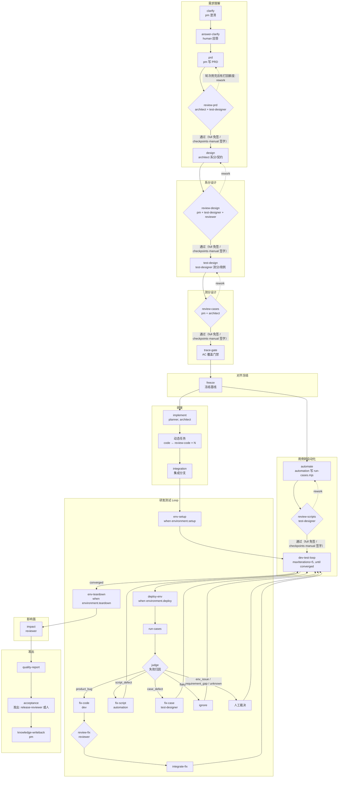

# Taktflow 真实流程与运行说明

> 状态：以主仓库当前实现为准的流程说明（2026-11-06）。本文写标准流程、角色能力、autonomy、加载边界与仓库差异；run-status 已接入 `takt_status` / `takt_run get`，具体实现与验证范围见文末「实现状态与验证」与「交付附录」。真实 standard e2e 已执行 5 批，前 4 批未通过，第 5 批跑到研发测试 loop 后升级给人、整体 `ok=false`；标准全链成功尚未验证，本文不填通过结论。

## 1. 快速使用

### 1.1 初始化空间

- 空间根是包含 `takt.config.json` 的目录；Lead 会话的 cwd 必须正好是它。
- 新目录在 Lead 会话里执行 `takt_requirement action="init"`：
  - 写 `takt.config.json`；
  - 创建 `agents/`、`workflows/`、`skills/`、`knowledge/`、`requirements/`（legacy 布局是 `.takt/` 下对应目录）；
  - 创建 `.takt/{runs,objects,chat}` 等运行目录；
  - 把随包默认角色与流程模板复制到空间目录（只补缺，不覆盖用户文件）。
- init 幂等；子目录、嵌套空间、与已绑定根冲突、symlink/特殊路径都会在写盘前拒绝。
- 新空间默认布局是顶层目录；旧项目继续沿用 `.takt/agents`、`.takt/workflows`、`.takt/skills`、`.takt/knowledge`、`.takt/workspaces`。

### 1.2 配置

`takt.config.json` 常用字段（以 core `TaktConfig` 为准）：

| 字段 | 作用 |
| --- | --- |
| `project.name` | 空间名；必填 |
| `workflows` | 已注册流程文件列表（相对空间根） |
| `paths` | 目录约定：`agents/workflows/skills/knowledge/requirements` |
| `repos` | 代码仓库绑定：`{ id, url?, path, defaultBranch, purpose? }` |
| `environment` | 被测环境：`setup/deploy/healthcheck/teardown/env` |
| `roles` | profile 模式下的角色默认 harness：`{ [role]: HarnessSelector }`；dsh-host 模式统一用 App 模型 |
| `lead` | core/CLI 字段（`harness` / `progressUpdates`）；当前 dsh 宿主未读取：Lead 执行器由 preset/App 模型控制，通知按宿主 notify 配置 |
| `sandbox` | 沙箱提供方：dsh-host 角色只支持 `local`；配置 `bwrap`/`docker` 会在启动前明确拒绝。`image`/`network` 是 core/CLI sandbox 字段 |
| `plugins` | core/CLI 字段（npm 包名或相对路径）；当前 dsh 宿主未接入 `loadPlugins`，不会因该字段自动加载 |
| `space.id` | 多空间 serve 的路由 id |

### 1.3 启动与汇报

1. `takt_status`：确认空间根、绑定需求、最近运行、当前 stage(s)、待办和可用流程。
2. `takt_requirement create`（title + 稳定 `requestKey`）或 `bind`。
3. `takt_run action="start" requestKey="<稳定唯一键>"`（workflow 可省略，省略时使用空间第一流程）：
   - 新空间首项默认 `taktflow-standard`；旧空间/自定义空间以首项为准，不要硬编码标准流程绕过自定义首流程；
   - 用户已明确要求启动时，create 成功后在同一回合继续 start；
   - `p0-delivery` 是演示流程，只在明确要演示时使用；
   - 可用流程以 `takt_status` 返回的 `workflows` 为准，不要臆造流程 ID。
4. 运行中用 `takt_status` / `takt_run get` 汇报：当前 stage(s)、review 当前/累计轮次与结论、loop 当前轮次/已观察最高轮次、真实待办。
5. full 档只有真实升级才 `takt_ask_human`；checkpoints/manual 的正常人工待办（检查点、评审签字、准出）仍呈现原生卡。普通评审通过、loop 迭代推进不打扰人。

> 主仓库当前实现：`takt_requirement init` 在新空间调用 `core.initProject` 后，会把配置 `workflows` 写成 `[workflows/taktflow-standard.workflow.ts, workflows/sdlc.workflow.ts]`（standard 第一、sdlc 第二），并复制随包角色与流程模板（只补缺，不覆盖用户文件）；已有空间只补缺失模板，不改配置里的流程顺序。Lead `takt_run start` 省略 `workflow` 时、HTTP POST 启动省略 `workflowId` 时，使用空间第一流程（流程目录 `defaultId`）；已初始化空间未配置流程时可用演示流程 `p0-delivery`，没有空间仍须先 `init`，生产启动不承诺无空间启动。实际可启动流程以 `takt_status` 返回值为准。

## 2. 标准流程：`taktflow-standard`

模板：`vendor/taktflow/templates/workflows/taktflow-standard.workflow.ts`（版本 `0.3.0`，9 个阶段）。

### 2.1 全节点流程图

### 2.2 阶段与节点

| 阶段 | 节点 |
| --- | --- |
| 需求理解 `understand` | `clarify` → `answer-clarify` → `prd` → `review-prd` |
| 系分设计 `design` | `design` → `review-design` |
| 测分设计 `test-design` | `test-design` → `review-cases` |
| 对齐冻结 `align` | `trace-gate` → `freeze` |
| 研发 `develop` | `implement`（planner）→ 动态 `code` → `review-code` → `integration`（与自动化阶段并行） |
| 用例转自动化 `automate` | `automate` → `review-scripts` |
| 研发测试 Loop `loop` | `env-setup` → `dev-test-loop`（内部见下）→ `env-teardown` |
| 影响面 `impact` | `impact` |
| 准出 `report` | `quality-report` → `acceptance` → `knowledge-writeback` |

### 2.3 review 与 rework

- 固定定义 5 个 review 节点：`review-prd`、`review-design`、`review-cases`、`review-scripts`、`review-fix`；每个 planner 任务还会动态展开 `code` → `review-code`，不计入这 5 个固定节点。
- 默认 `maxRounds=3`，`humanSignoff=true`，`onExhausted={ rework: <作者节点>, maxReworks: 1 }`；full 运行会关闭 humanSignoff，checkpoints/manual 保留。
- 评审不通过时作者按意见修改，再进入下一轮；`maxRounds` 用完后，如果 `maxReworks` 还有额度，先按 `onExhausted` 打回作者并重置评审；只有打回额度也耗尽时才转人工裁决或失败。不是每次 review 轮次耗尽都升级。
- 运行参数可覆盖：`args.review = { maxRounds, maxReworks, humanSignoff }`；`args.reviews[节点ID]` 覆盖单个评审。
- 累计轮次必须按 `review.round` 事件数统计；节点上的 `round` 在打回后会归零，只能表示当前轮次。
- `review-fix` 只在 `fix-code` 真的产生修复时执行（`when: codeWasFixed`）。
- 节点取消（`cancelled`）优先于最近一轮 `passed`；`latestRound` 仍保留 AI 当轮结论，不能显示为已通过。

### 2.4 planner 动态任务

- `implement` 是 `planner` 节点：`role=architect`、`maxItems=12`、`allowedRoles=['dev']`，由 `expandTask` 把实现拆成有边界的任务。
- 每个动态任务带 `key/title/dependsOn/role/params.repo`；vendor 的 `expandTask` 展开成 `code`（dev）→ `review-code`（reviewer，`maxRounds=3`、`humanSignoff`、打回 `code`、`maxReworks=1`），运行图把展开节点画在 planner 下面。
- `automate` 与 `implement` 都只依赖 `freeze`，研发与自动化并行；loop 同时依赖 `integration` 与 `review-scripts`。
- 动态节点定义会持久化到 `RunState.expansions[].nodes`，stale 传播和运行图以它为准。
- 任务完成后 `integration` 把改动集成到集成分支；loop 再基于集成结果执行用例。

### 2.5 研发测试 Loop

- `dev-test-loop`：`maxIterations=5`，`until: converged`，`onExhausted: 'human'`。
- 循环体：`deploy-env`（有 `environment.deploy` 时）→ `run-cases` → `judge`。
- `judge` 路由：
  - `product_bug` → `fix-code` → `review-fix` → `integrate-fix` → 下一轮；
  - `script_defect` → `fix-script` → 下一轮；
  - `case_defect` → `fix-case` → 下一轮；
  - `flaky` → `ignore` → 下一轮；
  - `env_issue` / `requirement_gap` / `unknown` → 人工裁决。
- `run-cases` 先校验实际脚本与评审产物 `scripts/run-cases.mjs` 一致（默认路径 `tests/run-cases.mjs`，可由 `args.testScript` 覆盖），再执行 `args.caseCommand ?? 'npm test'`；证据写到 `evidence/**`。automation 在空间根生成脚本，标准流程把它复制到集成分支执行；e2e 配置用 `caseCommand: 'node tests/run-cases.mjs'` 才走 runner。
- 轮次用完仍不收敛时，按 `onExhausted: 'human'` 生成待办；这不是普通评审签字，而是真实升级。
- `iteration` 在 generation 重置后会重来，状态只报“已观察最高轮次”，不叫累计执行次数。
- 节点早期失败（未达到 `maxIterations`）单列 `failed`，不冒充 loop 轮次预算耗尽；达到 `maxIterations` 且存在待办/节点失败才算耗尽。

### 2.6 环境 setup / deploy / teardown

- 配置来自 `takt.config.json.environment`：
  - `setup`：每次运行只执行一次，`env-setup` 节点在 `when: hasEnvironmentSetup` 时运行；
  - `deploy`：每次 loop 迭代部署，`deploy-env` 节点在 `when: hasEnvironment` 时运行；
  - `healthcheck`：`command` 或 `url`，默认 120 秒、每 2 秒探测；
  - `teardown`：成功、失败、取消都会尝试回收（120 秒超时）；回收失败只记日志，不保证资源全部清理；`env-teardown` 在 `when: hasEnvironmentTeardown` 时运行；
  - `env`：支持 `${ENV_NAME}` 宿主变量引用，日志脱敏。
- 没有配置 `environment` 时，setup/deploy/teardown 节点跳过，不影响主流程。

### 2.7 准出与知识回流

- `quality-report` 汇总质量报告；`acceptance` 是准出审批节点（`form: approve`）；`knowledge-writeback` 由 pm 整理业务规则、决策与教训，输出知识库修改建议，供人合入。
- full 档的准出 approve 由独立只读 `release-reviewer` 按冻结证据判定：证据充分时自动 approve，低置信、blocker、证据不足才升级给人，不是无条件放行。checkpoints/manual 保留人工准出。

### 2.8 `p0-delivery` 演示流程

- 阶段：澄清 → 系分 → 审批 → 实现 → 测试 → 报告。
- 节点：`clarify`（analyst，只读）→ `design`（architect）→ `approve-design`（human approve；full 档由 release-reviewer 判定，checkpoints/manual 待人）→ `implement`（dev，写 `src/**`）→ `test`（script，默认 `npm test`）→ `report`（reporter）。
- 用途是演示和冒烟；真实交付用 `taktflow-standard`。P0 流程不支持 review 节点、不允许任何节点声明 `allowBash`。

## 3. 角色能力

下表按 `vendor/taktflow/templates/agents/*.md` 的实际 frontmatter 填写。`readScope` 未声明表示没有额外读取限制；`writeScope` 是角色默认写范围，节点只能收窄。

| 角色 | harness（profile 模式） | skills | readScope | writeScope | 人工/升级责任（按标准模板节点） |
| --- | --- | --- | --- | --- | --- |
| `pm` | claude-code, effort high, fallback codex | `[]` | 未声明 | `.takt/workspaces/**`, `requirements/**` | 澄清回答（`answer-clarify`）、PRD 评审签字、知识回流 |
| `architect` | claude-code, effort high, fallback codex | `[]` | 未声明 | `.takt/workspaces/**`, `requirements/**` | 系分/契约、planner 拆任务；PRD/design/cases 评审 |
| `dev` | codex, effort high, fallback claude-code | `[]` | 未声明 | `src/**`, `package.json`, `.takt/workspaces/**/tasks/**`, `requirements/**/tasks/**` | 实现、修代码；`review-fix` 作者 |
| `reviewer` | claude-code, effort high, fallback codex | `[]` | 未声明 | `.takt/workspaces/**/reports/**`, `requirements/**/reports/**` | 代码评审、影响面评估 |
| `test-designer` | claude-code, effort high, fallback codex | `[]` | `.takt/workspaces/**`, `requirements/**` | `.takt/workspaces/**`, `requirements/**` | 测分/用例、修用例；PRD/design/scripts 评审 |
| `automation` | codex, effort high, fallback dsh, claude-code | `[]` | 未声明 | `requirements/**/scripts/**`, `.takt/workspaces/**/scripts/**`, `tests/**`, `.takt/workspaces/**/evidence/**`, `requirements/**/evidence/**` | 自动化脚本、修脚本；`review-scripts` 作者 |
| `judge` | claude-code, effort high, fallback codex | `[]` | 未声明 | `.takt/workspaces/**/reports/**`, `requirements/**/reports/**` | 失败归因；`env_issue`/`requirement_gap`/`unknown` 路由到人 |
| `lead` | claude-code, fallback codex | `[]` | 未声明 | `[]` | 协调、呈现升级；不写代码、不伪造人批准；`allowBash: false` |

补充：

- `src/roles/defaults.ts` 的 `BUNDLED_ROLE_FILES` 由三部分组成：随包 vendor 模板 8 个角色（`architect`、`automation`、`dev`、`judge`、`lead`、`pm`、`reviewer`、`test-designer`）、legacy 角色 `analyst`、`reporter`，以及内部只读角色 `release-reviewer`。`takt_requirement init` 复制的是这整套角色（只补缺，不覆盖用户档案）；标准流程用到的 `pm/test-designer/reviewer/automation/judge` 在新空间里默认已有档案。
- 角色档案里的 `harness` 是 profile 模式的声明值（例如 vendor 模板的 claude-code/codex/effort/fallback）；默认 `roleHarness=dsh-host` 时角色统一使用 App 的模型配置，只有 `profile` 模式才按档案里的 harness 配置执行。
- 内置只读角色 `release-reviewer`（`src/roles/defaults.ts`）：harness `dsh-host`、skills `[]`、writeScope `[]`、allowBash false；full 档准出 approve 由它按冻结证据独立判定，低置信/blocker/证据不足才升级给人。
- 角色档案字段：`role/title/description/harness/skills/readScope/writeScope/allowBash`。
- `skills` 是该角色可加载的技能名；技能内容由空间 `skills/` 提供并注册为角色局部技能，不能继承全局 skill 工具。
- `readScope` 是相对空间根的 glob；登记时拒绝绝对路径。`writeScope` 是 glob 白名单，越界会被权限守卫拒绝并记录。
- 执行器默认 `roleHarness=dsh-host`：所有角色（含 review/动态节点）使用 App 的模型配置；只有 `roleHarness=profile` 才沿节点声明 > 角色档案 `harness` > `takt.config.json.roles[role]` 的配置解析，并走对应 CLI 适配器/fallback。
- `lead` 行是 profile 模式下的档案值；dsh 宿主的 Lead 实际执行器由 preset/App 模型控制，不读取 `takt.config.json.lead.harness`。
- 角色能力不足时改角色档案或流程，不要在提示词里虚构字段或工具。

## 4. Autonomy 三档

> 插件配置提供默认档位（默认 `full`）；空间 `takt.config.json.autonomy` 可覆盖，非法值明确失败；运行开始时冻结。

| 档位 | 普通 human 节点（澄清回答、普通待办） | 准出 approve | review humanSignoff | review/judge/loop 升级 | 自动回答的落账 |
| --- | --- | --- | --- | --- | --- |
| `full`（默认） | 普通 answer 由宿主 AI（pm）按冻结证据自动回答 | 独立只读 `release-reviewer` 按证据判定；低置信/blocker/证据不足升级 | 关闭 | review 轮次用完且打回额度也耗尽、loop 达到 `maxIterations`、judge 路由 `human`、低置信/blocker/证据不足时升级 | actor 为 agent，`onBehalfOf` 绑定的人；证据写 `decisions/auto-answers/<requestId>.md`（升级项 `disposition=escalate`） |
| `checkpoints` | 普通澄清由宿主 AI 代答；流程声明的人工检查点待人 | 人工（准出检查点） | 保留 | loop/judge 真实升级仍交人；检查点之外不额外打扰 | 检查点内不代答；其它自动回答落账同 full |
| `manual` | 所有人工待办都由人处理 | 人工 | 保留 | 真实升级同样交人 | 不自动代答 |

边界：

- full 档普通 answer 由 pm 代答；准出 approve 由独立只读 `release-reviewer`，不是通用 auto-answer；review 签字、judge/loop 升级仍按真实升级/检查点处理。
- checkpoints/manual 的正常人工待办（检查点、评审签字、准出）仍要呈现原生卡；“只有真实升级才 `takt_ask_human`”只适用于 full，不能因为不算升级就永不问人。
- 自主升级必须来自真实决策产物/持久化状态（helper 的 `getEscalation` 返回 `{reason, source}`，marker=`autonomy.escalated`）；不能仅因 `handling=human` 当升级，Lead 只呈现真实升级，不伪造人的批准/打回。
- AI 代答必须走与人工相同的 freshness / 租约 / attempt / 证据版本校验，不能绕过冻结。
- 自动回答只允许普通 human 节点；review 签字、judge 升级也是待办，不能仅按 `form` 判断。
- 自动回答失败、低置信、存在 blocker/unresolved、证据缺失时升级，不猜答案。
- 升级后由 Lead 用 `takt_ask_human` 呈现给人；AI 正在处理的待办不算升级，通知器应抑制普通待办，只对真实升级发通知。
- 同一 request 只尝试一次；重启中断的交人，不重复覆盖已有 trace。

## 5. 空间初始化、默认流程与角色 harness

- `core.initProject(dir, { name, layout? })`（core 裸初始化）：
  - 新空间默认 `layout: 'space'`，`paths` 为顶层 `agents/workflows/skills/knowledge/requirements`；
  - legacy 布局为 `.takt/{agents,workflows,skills,knowledge,workspaces}`；
  - 默认 `workflows` 写 `workflows/sdlc.workflow.ts`（legacy 为 `.takt/workflows/sdlc.workflow.ts`）。
- `takt_requirement init`（插件初始化）：
  - 新空间先调用 `initProject`，再把配置 `workflows` 写成 `[workflows/taktflow-standard.workflow.ts, workflows/sdlc.workflow.ts]`，standard 第一；
  - 复制 `BUNDLED_ROLE_FILES`（vendor 8 角色 + `analyst`/`reporter` + `release-reviewer`）与 `BUNDLED_WORKFLOW_FILES`（`sdlc.workflow.ts`、`taktflow-standard.workflow.ts` 及 hooks/integration）到空间目录，只补缺、不覆盖用户文件；
  - 已存在空间只补缺失角色/流程模板，不改配置里的流程顺序。
- 新空间默认流程是 `taktflow-standard`（第二项是精简 `sdlc`）；`p0-delivery` 仅演示。Lead `takt_run start` 省略 `workflow` 时、HTTP POST 启动省略 `workflowId` 时使用空间第一流程；实际可启动流程以 `takt_status.workflows` 为准。
- 角色 harness 解析：默认 `roleHarness=dsh-host`：所有角色（含 review/动态节点）使用 App 的模型配置；只有 `roleHarness=profile` 才沿节点声明 > 角色档案 `harness` > `takt.config.json.roles[role]` 的配置解析，并走对应 CLI 适配器/fallback。`lead.harness`/`lead.progressUpdates` 是 core/CLI 字段；当前 dsh 宿主未读取，Lead 使用 preset/App 模型，通知按宿主 notify 配置。
- 运行开始会冻结流程、角色、技能、autonomy 与 harness 配置；`autonomyAttempts` 不是开始时冻结的字段，每次自主模型调用前追加并持久化；运行中改磁盘不会热替换已启动的运行。

## 6. 信任边界

- 空间 `.workflow.ts` 在 dsh 宿主进程内 import 并执行，没有独立沙箱；信任边界等同于安装一个插件。只应加载可信来源的流程。
- `takt.config.json.plugins` 是 core/CLI 字段；当前 dsh 宿主未接入 `loadPlugins`，不会因该字段自动加载插件。
- 流程模块与函数型 `script` 回调在宿主进程内执行；字符串形式 `script` 与环境命令通过 `spawn('sh', ['-c', ...])` 子进程执行，但没有额外安全沙箱，仍能改空间文件或调用本机命令。
- 角色 Agent 的代码写入受 `writeScope` 与权限守卫限制，但 Agent 仍在宿主管理的子会话里运行；不要把不可信流程代码当成“只是数据”。
- 当前 shell 已是子进程，但不提供额外安全沙箱；不要把流程源码或环境命令当成“只是数据”。

## 7. Node 24 工作流加载限制

空间流程由 `WorkflowFileLoader` 加载（实现位于主仓库 `src/workflows/loader.ts`）。约束如下：

| 项 | 规则 |
| --- | --- |
| 支持扩展名 | `.ts`、`.js`、`.mjs`；JSON 等其它资源明确拒绝 |
| 允许的 import | 相对路径、绝对路径、`file:` URL、`node:` 内置模块，以及本插件随包提供的 `@taktflow/*` 运行库 |
| 明确拒绝 | 未随包提供的第三方裸包、未提供的 `@taktflow/*` 子包、带查询串的本地路径、闭包外相对依赖 |
| 动态 import | 字面量 `import('./x.js')` 会收集进闭包；变量、拼接、模板插值等非字面量明确拒绝 |
| TypeScript | Node 24 原生擦除类型；模板按 NodeNext 写 `./x.js`，loader 优先解析同名 `.ts` 源文件；声明级 `import type` 跳过 |
| 冻结 | 先读取完整依赖闭包（源文本 + importer→specifier→目标边表）并计算内容哈希，再用同一份源码求值；已启动运行不受磁盘后续变化影响 |
| 版本 | 快照版本放进 URL 查询串（`taktv=<hash>`），按版本隔离 Node 模块缓存；新 load 看到依赖变化，旧 runtime 保持旧快照 |
| 随包模块 | `@taktflow` 运行库解析到本插件随包入口：`core` 固定 `lib/core.js`，`sandbox` 等使用独立 entry 并统一映射；目标随包列表含 `harness`/`knowledge`/`server`/`workflow-source`，最终列表以主 runtime 构建产物为准。哈希包含入口，不同入口得到不同版本 |
| 进程级状态 | module hook 是进程级的；多个 loader/service 共享快照表与 hook，但按插件 lib 根限定作用范围，不劫持无关包 |

注意：

- 加载器在构造时就要登记 `@taktflow` 运行库的运行时映射（至少 core/sandbox；目标含 harness/knowledge/server/workflow-source），因为 core 会动态 `import('@taktflow/sandbox')`，不能等第一次空间流程 load 才安装 hook。
- `@taktflow` 运行库解析到本插件随包入口；未提供的第三方包明确失败。最终随包列表以主 runtime 构建产物为准，不要把 core/sandbox-only 写成永久产品边界。
- loader 的随包入口列表以主 runtime 构建产物为准；未提供的包明确失败，不回落到用户空间里的另一份依赖。
- 变量动态 import 无法冻结时选择明确失败，不声称“完整冻结”后读取变化文件。
- Node 24 的 TS 擦除与 module hook 已在真实 Node v24.20.0 隔离进程验证（loader 29/29）；Vitest 的转换仍可能掩盖部分差异。
- 真实 dsh 安装别名下，loader 通过模块 URL 别名（保留实际入口与 canonical root）解析 `@taktflow/sandbox`；`scripts/build.mjs` 用 onLoad 把 vendor `execution.ts` 的唯一 `import(name)` 转成字面量 `import('@taktflow/sandbox')`，esbuild 生成相对 chunk lazy import。源码形状变化会让 build 失败，vendor 未改。

## 8. 本地 RepoManager 与 URL 仓库差异

`RepoBinding` 字段：`id`、`url?`、`path`、`defaultBranch`、`purpose?`。`defaultBranch` 必填。

| 项 | 本地 `path`（无 `url`） | URL（有 `url`） |
| --- | --- | --- |
| 源目录 | `resolve(projectDir, repo.path)`，直接使用本地已有仓库 | `.takt/repos/<id>`，`git clone --mirror` 到该目录 |
| 同步 | 读 `refs/heads/<defaultBranch>` | `fetch --prune origin +refs/heads/*:refs/remotes/origin/*`，读 `refs/remotes/origin/<defaultBranch>` |
| worktree | `.takt/worktrees/<runId>/<nodeId>`，分支 `takt/<runId>/<nodeId>` | 同上 |
| mirror | 不创建 mirror | 创建并维护 mirror |
| diff | 同一实现：`git diff --binary` + untracked | 同左 |
| 清理 | `git worktree remove --force` + `prune` | 同左 |

要点：

- 本地 `path` 是直接在项目仓库上开 worktree，不做 mirror；URL 才在 `.takt/repos/<id>` 建 mirror。
- 两种模式都以 `defaultBranch` 为基线，`createWorktree` 可显式传 `base`。
- worktree 路径必须在 `.takt/worktrees/<runId>/<nodeId>` 下，拒绝符号链接和越界路径。
- 节点上的 `repo` 字段绑定 `TaktConfig.repos` 的 id；没有 repo 的节点（如 automation）在空间根生成脚本。

## 9. 子 Agent 追溯与多 session

- 追溯文件在 `.takt/runs/<runId>/agents/`：
  - 首次执行写 `<nodeId>#<attempt>.json`；
  - 同一 node/attempt 的后续执行（例如 review 节点顺序调用多个评审者/作者）写 `<nodeId>#<attempt>~<sessionId>.json`，每个 session 独立一条，不能覆盖前一条。
- 读取时按 `(runId, nodeId, attempt, sessionId)` 合并，保留每次调用；运行中的记录合并内存里的最新状态；重启后读取磁盘上已落盘的记录。
- 前端注意：
  - 一个 node/attempt 可能对应多个 session，不能假设“一个节点一条 trace”；
  - `AgentTrace` 没有 `parentSessionId`，打开子会话时从运行归属 `owner.json` 的 `ownerSessionId` 补父会话；
  - 只传 `sessionId` 也能打开，但显式 `parentSessionId + childSessionId` 更稳；
  - `model/effort` 拿不到实际请求配置时留空，不猜默认档位。
- trace 的 prompt/systemAppend/finalText/error/denial 都先脱敏再按字节截断；工具调用最多保留最近 200 条。
- 面板数据源契约（`src/client/source.ts`）：读走 `GET ./api/taktflow?space=&p=<op>`，写走 `POST ./api/taktflow.op`；POST 白名单共 14 项（4 个插件写 + 10 个 core 写），子 Agent 追溯走 `GET ./api/taktflow.agents`。运行事件与流程修订用 SSE（`taktflow.stream`、`taktflow.workflow-stream`）；workflow 冲突返回 409 + `conflict`，校验失败返回 400 + `validation.diagnostics`。当前前端只展示 `error.message`，`validation` 原对象没有透出；扩展前端时应保留 `validation.diagnostics`，不要只留文案。群聊（`room`/`chat`）读写都不开放，需求群就是 dsh 会话。

## 10. 实现状态与验证

本模块交付范围：

- 标准流程 `taktflow-standard`：9 个阶段、5 个固定 review 节点（另有每个 planner 任务动态展开的 `review-code`）、planner 动态任务、研发测试 loop、影响面与准出；节点图见 §2。
- 角色能力：随包 vendor 8 角色 + legacy `analyst`/`reporter` + 内部只读 `release-reviewer`；skills/readScope/writeScope、dsh-host 与 profile 两种 harness 解析见 §3。
- autonomy 三档：full/checkpoints/manual 的配置读取、AI 代答/准出落账、升级与通知接线；边界见 §4。
- run-status：`buildRunStatus` 是 Lead `takt_status` / `takt_run get` 的增量字段，旧 `run`/`attention` 字段保留；HTTP GET `p=run` 仍返回 core `RunDetail`；`isAiHandling` 读取进程内真实 claim 标记，`getEscalation` 从 `decisions/auto-answers/*.md` 的 `处置：escalate` 决策产物读取 `{reason, source}`（source 为产物路径@版本）。旧运行缺 workflow 快照时只把 `runStatus` 降级为 `{ error }`，不影响只读状态工具。
- 流程加载器与构建：`src/workflows/loader.ts` 的 Node 24 原生加载、依赖闭包冻结、版本隔离与随包入口映射；运行时 symlink 双 root 别名与真实 core 单例回归；build 对 vendor 的唯一 `import(name)` 做字面量改写，不修改 vendor。
- 前端契约：trace 多 session、owner 父会话补全、`model/effort` 不猜默认；面板数据源契约见 §9。
- 仓库与恢复：本地 `path` 不建 mirror、URL 才 mirror；唯一 legacy `main` 追加 `app` 别名并保留 `defaultBranch`；冷恢复仅限无函数且 identity/owner 一致的 `waiting_human` 运行；含函数流程的运行在新宿主拒绝恢复，无论磁盘快照是否存在。

验证范围（已实跑）：

- `npm run build` 成功；`npx tsc -p tsconfig.json --noEmit` 退出 0；全量 `npx vitest run` 为 **35 个文件 / 548 项测试通过**（Node v24.20.0、dsh 0.2.2-rc.1）。新增真实 symlink/core 单例 2 项、build literal 形状 2 项。
- 流程加载器真实 Node 24 隔离进程 29/29；发布包 workflow 探针 5/5（临时目录无 `vendor`、无本地 `node_modules`、清 `NODE_PATH`）。
- 历史 P0 演示流程 `p0-delivery` 的真实 dsh + 模型批次 25/25，属于历史演示流程验收，不代表标准流程通过。

真实 standard e2e（5 批均已执行，第 5 批最终升级）：

- 第 1 批：33 项账本 1 fail + 14 not-run；Lead 动态流程目录遗漏 `taktflow-standard`，`takt_run start` 返回 `TAKT_UNSUPPORTED_NODE`，未生成 runId；已修。
- 第 2 批：33 项账本 12 fail；run 已启动，`clarify` 前 `@taktflow/sandbox` 解析失败；已修。
- 第 3 批：34 项账本 12 fail；真实 dsh coreSingleton 全部 true，仍在 `clarify` 前 `@taktflow/sandbox` 解析失败；已修。
- 第 4 批：34 项账本 8 fail；PM AI 代答完成；PRD/系分/测分各 1 轮交叉评审，动态代码评审 1 轮，脚本评审 1 轮，共 5 轮；read denial、dev/reviewer Skill 隔离、core 单例均 PASS；1 轮 `run-cases` 执行 9 条生成用例 8 pass / 1 fail；独立 6 项数学产品断言 PASS（不能并入 9 条生成用例）；只改 `src/add.js`，原 test/package 保持；REG-001 缺 `TAKT_REGRESSION_BASELINE_REV`，被 judge 以 `env_issue` 0.99 升级（1 个 requestId，两次观察不能计为 2 次升级）；18 条职责 trace 全有 usage（输入 295433 / 输出 34337），Lead 24955 / 356，合计 320388 / 34693；pipeline elapsed 863861ms（停在升级），整个 e2e 985673ms；未到质量报告/准出/知识回流，整体未通过，完整 audit 验收也未通过（EventStore.verify 单项通过，但缺少准出 AI 代答留痕，需按 JSON 分开看）；host stop/home cleanup PASS。
- 第 5 批：run `run-20261106-124857-4d67`，requirement `REQ-3AB8FDFD0134`；真实 dsh `0.2.2-rc.1`、宿主 Node `v24.20.0`、App Node `v24.21`；`autonomy=full`，最终 judge 升级待办保持未回答。e2e 从 `2026-11-06T04:48:27.138Z` 到 `05:11:58.089Z`，总 1410951ms（23 分 30.951 秒）；流水线到升级 1284161ms（21 分 24.161 秒），这是升级前用时，不是运行成功耗时。34 项验收 26 通过 / 8 失败、整体 `ok=false`；失败项：`run-finished`、`no-escalation`、`role-exact`（没有 `release-reviewer` trace）、`loop-ran`（judge `waiting_human`）、`evidence-summary`、`quality-report`、`auto-answers`（acceptance 没执行）、`audit-verify`（只有 1 条 `human.answered`，缺准出 AI 代答留痕）。34 项是验收项，不是 34 条业务用例。
- 第 5 批业务结果：生成 12 条用例首轮 9 通过 / 3 失败（`TC-DEL-001`、`TC-REG-001`、`TC-REG-002`）；独立 6 项产品 AC 通过，不能并入 12 条分母；只改 `src/add.js`，原测试与 `package.json` 保持、原 app 仓库未被改。PRD 评审 2 轮、系分 1 轮、测分 1 轮、动态代码评审 1 轮、脚本评审 2 轮，共 7 轮且最后都通过，有真实作者回改和多 session 记录。`run-cases` + `judge` 第 1 轮已执行，但 judge 停 `waiting_human`，不能称 loop 完整通过或收敛。
- 第 5 批升级与 trace：1 个唯一升级 requestId（ledger 两次观察不能计为 2 次）；`TC-DEL-001`、`TC-REG-001` 判 `env_issue`，缺 Agent 变更前完整文件清单及可信 SHA256（`TAKT_CHANGE_ORIGIN_MANIFEST` / `TAKT_CHANGE_ORIGIN_SHA256`）；`TC-REG-002` 判 `script_defect`，正则误把正常 TAP 汇总 `# todo 0` 识别成 TODO 指令，judge 给了 fix-script 路由，但与 `env_issue` 混合后需人工裁决，未继续修复。23 条职责 Agent trace 全有 usage：输入 408668 / 输出 53348；Lead 17282 / 331；合计 425950 / 53679（含 Lead，按观测 usage 字段，不换算费用）。
- 第 5 批基线与通过项：此前补的 `TAKT_REGRESSION_BASELINE_REV` 实际已被消费，`git show` 真实初始 SHA `cad08a234ed7e93e56a2f4dc6a910e90667f8e2f` 成功、原测试与 `package.json` 逐字节匹配，第 4 批的基线缺失已解决，不能把第 5 批写成同一个缺基线。core 单例、init 模板、三类交叉评审、read denial、dev/reviewer 技能隔离、生成物、独立 product-acceptance、进程停止、home 清理均 PASS；完整审计验收失败，不能把缺准出回答等同链损坏，也不能反推链验收全过。证据归档在 `e2e/out/standard-history/`。

验证：

- 真实 standard e2e 已执行 5 批：前 4 批未通过，第 5 批在研发测试 loop 后升级给人、整体 `ok=false`，标准全链成功尚未验证；无第 6 批，不写全链 PASS。

## 11. 交付附录

### 11.1 改动

- 角色能力：`PermissionScope` 的可选 `readScope` 与双域 `writeScope`（代码按 cwd、公共产物按 `artifactRoot`，越界/符号链接 fail closed）；角色 skill 按档案局部注册与隔离；dsh-host 支持 worktree cwd、`local` sandbox 与 trace 记录实际注册 skills。
- preset：角色 preset 记录 `id`/`cfgHash`/`plugins` 与实际注册 `skills`；运行开始冻结角色、技能与 harness 配置。
- autonomy：`full`/`checkpoints`/`manual` 三档；AI 代答与准出落账、真实升级通知；运行开始冻结 `autonomy`/`roleHarness`，`autonomyAttempts` 在每次自主模型调用前追加并持久化。
- run-status：`buildRunStatus` 输出 stage(s)、review 当前/累计轮次、loop 当前/已观察最高轮次、待办与真实升级来源；作为 Lead `takt_status` / `takt_run get` 的增量接入，HTTP GET `p=run` 仍返回 core `RunDetail`。
- Lead：初始化复制角色/流程模板、默认流程 `taktflow-standard`、prompt/skill 的 autonomy、roleHarness、review 打回与问人边界。
- 路由/面板：GET 读操作、14 项 POST 白名单（4 个插件写 + 10 个 core 写）、运行与流程修订 SSE、子 Agent 追溯路由；workflow 冲突 409 + `conflict`，校验失败 400 + `validation.diagnostics`。
- 流程加载与构建：Node 24 loader、依赖闭包冻结与版本隔离、运行时 symlink 双 root 别名、真实 core 单例回归、build 字面量 import 改写、workflow 校验。
- e2e：standard fixture/probe/standard 脚本、integration default branch helper、runtime symlink helper；standard 批次证据归档在 `e2e/out/standard-history/`（第 1–5 批、第 4 批升级与第 5 批首轮）。
- 文档：`README.md`、`docs/real-flow.md`、`docs/spike-notes.md`。

### 11.2 文件清单（67 个，相对仓库根）

- 根目录（1）：`README.md`
- `docs/`（2）：`docs/real-flow.md`、`docs/spike-notes.md`
- `e2e/`（5）：`e2e/helpers/integration-default-branch.mjs`、`e2e/helpers/runtime-symlink.mjs`、`e2e/standard-fixture.mjs`、`e2e/standard-probe.mjs`、`e2e/standard.mjs`
- `scripts/`（1）：`scripts/build.mjs`
- `src/` 顶层入口（7）：`src/core-entry.ts`、`src/harness-entry.ts`、`src/knowledge-entry.ts`、`src/sandbox-entry.ts`、`src/server-entry.ts`、`src/workflow-source-entry.ts`、`src/workflow-validation-runner.ts`
- `src/host/`（37）：`src/host/agent-trace.test.ts`、`src/host/agent-trace.ts`、`src/host/approvals.test.ts`、`src/host/approvals.ts`、`src/host/autonomy-state.ts`、`src/host/autonomy.test.ts`、`src/host/autonomy.ts`、`src/host/bindings.ts`、`src/host/build-core-import.test.ts`、`src/host/bundled-templates.test.ts`、`src/host/dsh-harness.test.ts`、`src/host/dsh-harness.ts`、`src/host/dsh-types.ts`、`src/host/index-lifecycle.test.ts`、`src/host/index.test.ts`、`src/host/index.ts`、`src/host/notify.test.ts`、`src/host/notify.ts`、`src/host/permissions.test.ts`、`src/host/permissions.ts`、`src/host/presets.test.ts`、`src/host/presets.ts`、`src/host/role-skills.test.ts`、`src/host/role-skills.ts`、`src/host/role/execution.test.ts`、`src/host/role/index.ts`、`src/host/routes.test.ts`、`src/host/routes.ts`、`src/host/run-runtime.test.ts`、`src/host/run-runtime.ts`、`src/host/runs.test.ts`、`src/host/runs.ts`、`src/host/runtime-symlink.test.ts`、`src/host/space.ts`、`src/host/types.ts`、`src/host/workflow-validation.test.ts`、`src/host/workflow-validation.ts`
- `src/host/lead/`（8）：`src/host/lead/index.test.ts`、`src/host/lead/init.test.ts`、`src/host/lead/prompt.ts`、`src/host/lead/run-status.test.ts`、`src/host/lead/run-status.ts`、`src/host/lead/skill.ts`、`src/host/lead/tools.test.ts`、`src/host/lead/tools.ts`
- `src/roles/`（1）：`src/roles/defaults.ts`
- `src/templates/`（1）：`src/templates/bundled.ts`
- `src/workflows/`（4）：`src/workflows/index.ts`、`src/workflows/loader.ts`、`src/workflows/p0-delivery.test.ts`、`src/workflows/p0-delivery.ts`

合计：1 + 2 + 5 + 1 + 7 + 37 + 8 + 1 + 1 + 4 = 67。

### 11.3 types 兼容增量

- `Autonomy = 'full' | 'checkpoints' | 'manual'`、`RoleHarness = 'dsh-host' | 'profile'`：新增类型，不替换旧字段。
- `RunOwnerMeta`：新增可选 `autonomy`、`roleHarness`、`autonomyAttempts`；`autonomy`/`roleHarness` 在运行开始时冻结，`autonomyAttempts` 是每次自主模型调用前追加并持久化的计数，不是开始时冻结的字段。历史运行缺这些字段时按保守语义恢复。
- `PermissionScope`：新增可选 `readScope`、`spaceRoot`、`artifactRoot`；`writeScope` 在提供 `spaceRoot`/`artifactRoot` 时按 cwd 代码域 + 需求公共产物域计算，缺省保持旧版“相对空间根”语义。
- `RolePresetHandle`：新增可选 `skills`（本次实际注册成功的角色 skill）；旧实现可省略。
- `AgentDecisionInput` / `AgentDecisionResult`：新增 AI 代答输入输出类型；`Approvals.answerAsAgent?` 为可选入口，与人工 `answer` 共用 freshness/attempt/lease 校验。
- `Notifier.notifyEscalation?`：新增可选升级通知；普通 `human.requested` 在 AI 处理期间抑制，只有真实升级补唤醒。
- `WorkflowCatalog`：`load(workflowId, space?)` 增加可选 space 限定；新增可选 `list(space?)`、`defaultId(space?)`；旧实现缺省时调用方回退 `ids()`/演示流程。
- `AgentTrace`：`preset.skills?` 与 `profile.skills`（实际注册）、`profile.declaredSkills?`（档案声明）；同一 node/attempt 可有多条 session 记录，前端按 `sessionId` 区分；`usage`/`denials`/`tools` 等字段保留。
- 无破坏性改名；新增字段/方法均为可选或向后兼容。

### 11.4 验证

- 见 §10：build 成功、typecheck 退出 0、**35 文件 / 548 项**单测通过；loader 29/29、发布包 workflow 5/5。
- 真实 standard e2e 已执行 5 批，前 4 批未通过；第 5 批跑到研发测试 loop 后升级给人、整体 `ok=false`，标准全链成功尚未验证（34 项验收 26 通过 / 8 失败；12 条生成用例首轮 9 过 3 失败；6 项产品 AC 独立通过）。

### 11.5 未做

- 未改 `vendor/`、`client/`、`package.json`，未提交。
- 无浏览器 UI 验收。
- `profile` 外部 CLI 未做真实 e2e。
- 第 5 批在研发测试 loop 后升级给人，未到质量报告/准出/知识回流；没有质量报告、没有 `release-reviewer` 真实证据，acceptance 未执行，完整 audit 验收失败（只有 1 条 `human.answered`，缺准出 AI 代答留痕）；不能宣称标准全链通过。
- P1（从节点重跑、产物回退、配方指纹、归因视图）未做。

### 11.6 限制

- 冷恢复分两种：无函数且 identity/owner 一致的 `waiting_human` 运行可由新宿主恢复；含函数流程的运行在新宿主拒绝恢复，无论磁盘快照是否存在。状态只读工具缺 workflow 快照时只把 `runStatus` 降级为 `{ error }`，不影响只读状态工具；trace 重启读取磁盘记录。
- dsh-host 角色只支持 `local` sandbox；配置 `bwrap`/`docker` 启动前明确拒绝。
- 第三方裸包、未随包 `@taktflow/*`、变量/拼接/模板插值等非字面量 dynamic import 明确拒绝。
- `package.json` 禁改，因此 `engines.dsh`/Node 声明仍需 Claude 按实际支持的 Node 24 + dsh 0.2.2-rc.1 同步。
- `TAKT_REGRESSION_BASELINE_REV` 是 e2e 基线约定，不是插件所有业务必配字段；第 5 批已实际消费该变量（`git show` 初始 SHA 成功、原测试与 `package.json` 逐字节匹配），第 5 批升级原因是缺 Agent 变更前清单/可信 SHA256（`TAKT_CHANGE_ORIGIN_MANIFEST` / `TAKT_CHANGE_ORIGIN_SHA256`），不是缺基线。缺失时应失败升级，不能用当前 HEAD 或固定答案冒充。
- 真实 e2e 依赖真实 dsh 安装目录、模型端点、基线 revision 和变更前清单/可信 SHA256；本机探针不能替代。

### 11.7 Claude 事项

- `runStatus`：保留旧 `run`/`attention` 字段；缺 workflow 快照时只降级 `runStatus`，不要把整个状态工具判失败。
- `AgentTrace` 的 key 用 `sessionId`：同一 node/attempt 可能有多个 session，不能假设“一个节点一条 trace”。
- 400 校验失败时服务端返回 `validation` 原对象，诊断在 `validation.diagnostics` 内（不是顶层 `diagnostics`）；当前前端只展示 `error.message`，扩展前端时应保留 `validation.diagnostics`，不要只留文案。
- 路由契约：GET 读 + 14 项 POST + SSE + 409 `conflict`；`room`/`chat` 读写不开放。
- `package.json` 禁改：`engines.dsh`/Node 声明由 Claude 同步实际支持的 Node 24 + dsh 0.2.2-rc.1。
- 完整 audit 验收需区分 `EventStore.verify` 单项结果与“缺少准出 AI 代答留痕”两项，按 JSON 字段分别记录。
- 第 5 批没有质量报告/准出/知识回流，也没有 `release-reviewer` 真实执行证据；`acceptance` 未执行，完整 audit 验收失败（只有 1 条 `human.answered`，缺准出 AI 代答留痕）；不要据此宣称标准全链通过。
- `profile` 外部 CLI 与浏览器 UI 未做真实 e2e，不能把 `dsh-host` 结果外推。
